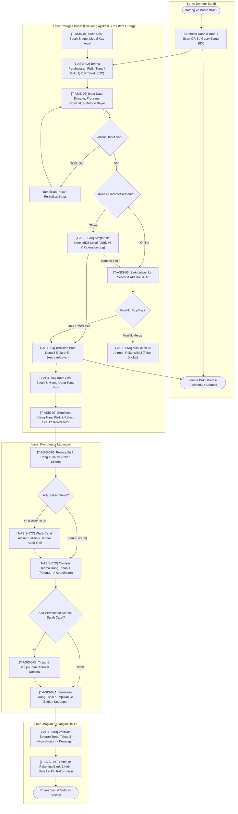
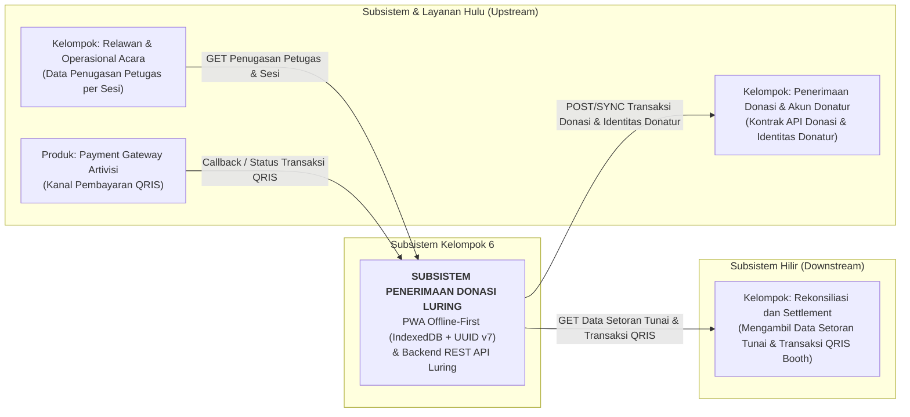
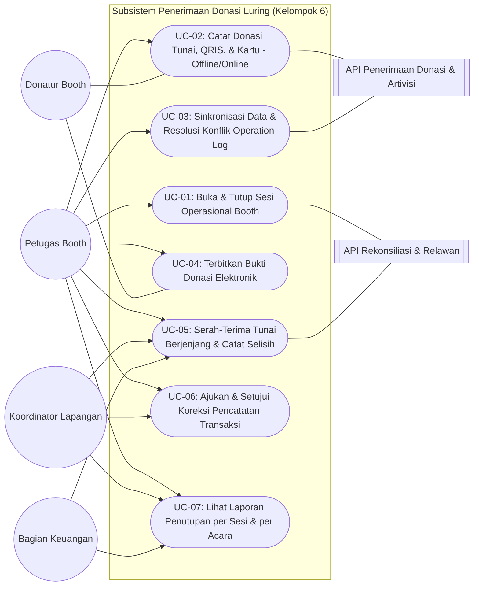
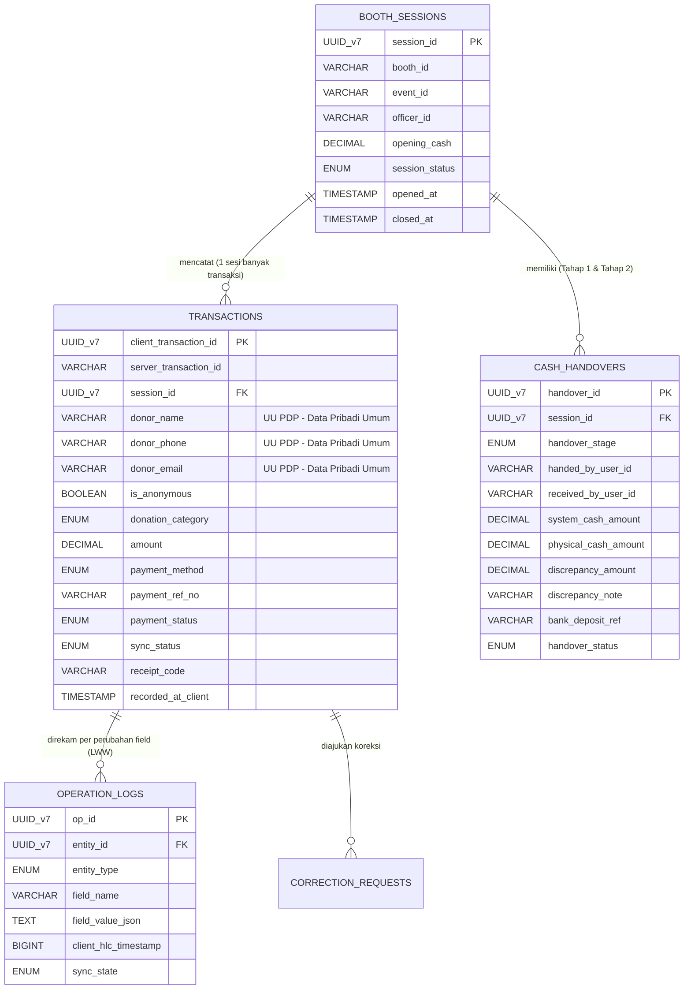

# SOFTWARE REQUIREMENTS SPECIFICATION (SRS)

## Subsistem Penerimaan Donasi Luring — Baitulmal Tazkia (BMTZ)

- **ID Dokumen:** BMTZ-SRS-OFFLINE-001
- **Lokasi File Repository:** `docs/srs.md`
- **Versi:** 0.3 (Penyelarasan Penuh Workbook Kelompok 6 & Kebutuhan Dosen)
- **Status:** Draft — Untuk Walkthrough & Sign-Off PIC Operasional Donasi
- **Tanggal:** 4 November 2026
- **Klien / Organisasi:** Baitulmal Tazkia (Sentul, Bogor)
- **Kelompok:** Kelompok 6 — Klaster Kanal dan Luring (Bobot Lingkup Penuh - 4 Mahasiswa)
- **Tim Pendamping:** Tim 2 — Kanal dan Operasional (Mahasiswa Semester 5)
- **Gelombang Cutover:** Gelombang 2 (Minggu 15)
- **Standar Acuan Utama:** ISO/IEC/IEEE 29148:2018 (Subklausul 8.5.2 & Klausul 9.6)
- **Acuan Kualitas Tambahan:** ISO/IEC 25010:2023 & CMMI-DEV v1.3 Tingkat Kematangan 3 (Defined)

---

### Kontrol Dokumen

| Versi | Tanggal | Deskripsi Perubahan | Status |
| :--- | :--- | :--- | :--- |
| 0.1 | 21 Oktober 2026 | Penyusunan awal SRS berdasarkan workbook proyek dan informasi yang tersedia. | Draft |
| 0.2 | 4 November 2026 | Penambahan Format Outline, Detail Proses Bisnis (As-Is & To-Be), Spesifikasi Field/Tipe Data/Validasi (Kamus Data), UI Mockup (Wireframe), dan metrik terukur pada NFR. | Draft |
| 0.3 | 4 November 2026 | Penyelarasan penuh dengan Bab 3 & Bab 7.1 Workbook Kelompok 6: Struktur baku ISO/IEC/IEEE 29148 (`1.1`–`5`), Peta Ketergantungan Hulu/Hilir (Artivisi, Balaka, Kelompok Lain), Catatan Teknis `UUID v7` + `Operation Log` (*Last-Write-Wins*), Tabel Dugaan Awal (Bab 3.1), 6 Pertanyaan Elisitasi Klien (Bab 3.3), Prioritas MoSCoW, User Story & Acceptance Criteria (`Given-When-Then`), serta RTM dengan ID Task BPMN. | Draft |

### Lembar Persetujuan Dokumen (Sign-Off Baseline Tingkat A)

| Peran | Nama / Jabatan | Status Persetujuan | Tanggal Sign-Off |
| :--- | :--- | :--- | :--- |
| **Pemilik Proses / PIC Klien** | PIC Bidang Operasional Donasi BMTZ *(Nama ditentukan pada Stakeholder Register)* | Menunggu Walkthrough Minggu 4 | TBD |
| **Dosen Pengampu** | Endy Muhardin | Menunggu Review Dosen | TBD |
| **Tim Pendamping (RC-1/RC-2)** | Tim 2 Kanal dan Operasional (Semester 5) | Menunggu Review Checkpoint | TBD |
| **Perwakilan Kelompok 6** | Koordinator Kelompok 6 (4 Anggota) | Disetujui Internal (Peer Review) | 4 November 2026 |

---

## DAFTAR ISI (FORMAT OUTLINE SESUAI BAB 7.1 WORKBOOK & TAMBAHAN DOSEN)

- **Kontrol Dokumen & Lembar Persetujuan (Sign-Off)**
- **Daftar Isi (Format Outline)**
- **1. Introduction (Pendahuluan)**
  * `1.1 Purpose` (Tujuan Dokumen & Sasaran Pembaca)
  * `1.2 Scope` (Ruang Lingkup Produk, Batas Sistem pada Model As-Is, & Luar Lingkup)
  * `1.3 Product perspective` (Perspektif Produk, Analisis Proses Bisnis As-Is vs To-Be, BPMN Swimlane, & Posisi Antar-Subsistem)
  * `1.4 Product functions` (Ringkasan Fungsi Subsistem & Use Case Diagram)
  * `1.5 User characteristics` (Karakteristik Pengguna Berdasarkan Lane As-Is & Stakeholder Register)
  * `1.6 Limitations` (Batasan UU PDP No. 27/2022, Data Sintetis, Larangan Kredensial di Repo, & Isolasi Database API)
  * `1.7 Assumptions and dependencies` (Peta Ketergantungan Hulu/Hilir, Dugaan Awal Bab 3.1, & Risiko Awal Bab 3.6)
  * `1.8 Apportioning of requirements` (Prioritisasi MoSCoW & Daftar Kandidat Change Request Proses To-Be)
- **2. References (Referensi Dokumen & Artefak Proyek)**
- **3. Specific Requirements (Kebutuhan Spesifik)**
  * `3.1 External interfaces` (Kebutuhan UI, **4 Rancangan UI Mockup / Wireframe**, & Kontrak Antarmuka Antar-Subsistem Hulu/Hilir)
  * `3.2 Functions` (Kebutuhan Fungsional FR-01 s.d. FR-17 dalam Format **User Story**, **Acceptance Criteria Given-When-Then**, & **Use Case Rinci**)
  * `3.3 Usability requirements` (Kebutuhan Kemudahan Penggunaan Terukur)
  * `3.4 Performance requirements` (Kebutuhan Kinerja Waktu Respons & Kapasitas Antrean Offline)
  * `3.5 Logical database requirements` (Entitas Data, **Spesifikasi Detail Field, Tipe Data, Validasi / Kamus Data UUID v7 & Operation Log**, Klasifikasi Data Pribadi UU PDP, & Retensi)
  * `3.6 Design constraints` (Batasan Perancangan: Pola Offline-First Aplikasi Surat Kecamatan, Layered Architecture, & Dependency Injection)
  * `3.7 Standards compliance` (Kepatuhan Regulasi UU PDP No. 27/2022, Pengelolaan ZISWAF, & Standar Teknis)
  * `3.8 Software system attributes` (Kebutuhan Nonfungsional / NFR Keandalan, Ketersediaan, Keamanan, Maintainability, & Portabilitas sesuai ISO/IEC 25010:2023)
  * `3.9 Supporting information` (Informasi Pendukung, Dugaan Formulir Kertas, & 6 Pertanyaan Elisitasi Klien Bab 3.3 Workbook)
- **4. Verification (Metode Verifikasi & Skenario Pengujian Acceptance Criteria)**
- **5. Appendices (Lampiran)**
  * `5.1` Daftar Istilah Domain Baitulmal Tazkia, Akronim, dan Singkatan
  * `5.2` Bidirectional Requirements Traceability Matrix (RTM) dengan Kolom ID Task BPMN
  * `5.3` Daftar Kandidat Change Request (Usulan Proses To-Be Minggu 5) & Risk Register Awal

---

## 1. Introduction

### 1.1 Purpose
Dokumen *Software Requirements Specification* (SRS) ini mendefinisikan kebutuhan perangkat lunak untuk **Subsistem Penerimaan Donasi Luring** pada **Baitulmal Tazkia (BMTZ)** yang dikerjakan oleh **Kelompok 6 (Klaster Kanal dan Luring)**. 

**Tujuan Subsistem bagi Baitulmal Tazkia:**
Mendigitalkan proses pencatatan penerimaan donasi luring (tunai, QRIS, dan kartu/EDC) pada kegiatan *booth* di pusat perbelanjaan (mal), masjid, dan lokasi acara yang memiliki keterbatasan koneksi internet (*offline-first*), memastikan sinkronisasi data ke sistem pusat tanpa duplikasi, menerbitkan bukti donasi elektronik bagi donatur, serta menyediakan jejak audit (*audit trail*) penuh atas serah-terima uang tunai secara berjenjang dari petugas *booth* kepada koordinator hingga bagian keuangan.

**Sasaran Pembaca Dokumen Ini:**
1. **PIC Bidang Operasional Donasi & Bagian Keuangan Baitulmal Tazkia:** Sebagai dasar validasi kebutuhan operasional dalam sesi *walkthrough* dan penandatanganan *sign-off baseline*.
2. **Anggota Kelompok 4 (Pengembang & Analis):** Sebagai acuan tunggal (*baseline*) untuk perancangan berorientasi objek (MISI.303), implementasi aplikasi web & API (MISI.302), serta pengujian.
3. **Kelompok Hulu dan Hilir (Penerimaan Donasi & Akun Donatur, Rekonsiliasi & Settlement, Relawan & Operasional Acara):** Sebagai acuan kesepakatan kontrak antarmuka (OpenAPI) pada batas subsistem.
4. **Tim Pendamping (Tim 2 Kanal dan Operasional - Semester 5) & Dosen Pengampu:** Sebagai artefak verifikasi dan validasi tingkat A dan B pada *Review Checkpoint* (RC-1 hingga RC-6) serta sidang evaluasi.

---

### 1.2 Scope
Subsistem Penerimaan Donasi Luring mencakup aplikasi web progresif (*Progressive Web App* / PWA) berarsitektur *offline-first* beserta layanan *backend* dan REST API miliknya sendiri. Sesuai ketentuan **Bab 3.2, Bab 3.4, dan Bab 8.3 Workbook**, aplikasi semester ini **mendigitalkan bentuk media kerja, pengisian data, dan validasi pada proses *as-is*** tanpa mengubah urutan *task*, pelaksana (*lane*), maupun aturan keputusan tanpa melalui prosedur *change request*.

#### Tabel Batas Sistem pada Model Proses As-Is (System Boundary)

| ID Task BPMN | Nama Task pada Model Proses As-Is | Pelaksana (Lane) | Status Dukungan Sistem | Bentuk Digitalisasi / Alasan Tetap Manual |
| :--- | :--- | :--- | :--- | :--- |
| **T-ASIS-01** | Terima penugasan sesi & siapkan modal kas *booth* | Petugas Booth | **Didukung Aplikasi** | Dari catatan lisan/WA menjadi layar Pembukaan Sesi Booth dengan data penugasan dari API Relawan & Operasional Acara. |
| **T-ASIS-02** | Terima uang fisik tunai atau proses mesin EDC/QRIS fisik | Petugas Booth & Donatur | **Tetap Manual (Luar Aplikasi)** | Penyerahan uang kertas fisik dan penggesekan kartu pada mesin EDC fisik tetap dilakukan secara fisik di *booth*. |
| **T-ASIS-03** | Catat rincian transaksi donasi & data kontak donatur | Petugas Booth | **Didukung Aplikasi** | Menggantikan penulisan kuitansi kertas/spreadsheet menjadi formulir input digital dengan validasi instan & penyimpanan lokal (`IndexedDB`) saat *offline*. |
| **T-ASIS-04** | Buat dan serahkan bukti donasi kepada donatur | Subsistem Luring / Petugas | **Didukung Aplikasi** | Menerbitkan bukti donasi elektronik (melalui nomor kontak/layar) bagi donatur yang memberikan nomor telepon/email. |
| **T-ASIS-05** | Rekap & ketik ulang data donasi *booth* ke sistem pusat | Petugas Booth $\rightarrow$ Subsistem Luring | **Didukung Aplikasi (Otomasi Sinkronisasi)** | Menghilangkan *bottleneck* ketik ulang manual oleh staf admin setelah acara melalui sinkronisasi otomatis ber-idempotensi (`UUID v7` + `Operation Log`). |
| **T-ASIS-06** | Hitung fisik uang tunai pada penutupan sesi *booth* | Petugas Booth | **Didukung Sebagian (Hybrid)** | Perhitungan lembar uang dilakukan manual oleh petugas, namun pencatatan nominal fisik & kalkulasi selisih terhadap rekap sistem dilakukan otomatis oleh aplikasi. |
| **T-ASIS-07** | Serah-terima uang tunai dari Petugas ke Koordinator | Petugas Booth & Koordinator | **Didukung Aplikasi** | Mencatat berita acara serah-terima berjenjang tahap 1 beserta alasan selisih dan otorisasi digital yang tercatat di *audit trail*. |
| **T-ASIS-08** | Serah-terima uang tunai dari Koordinator ke Keuangan & setor bank | Koordinator & Bagian Keuangan | **Didukung Aplikasi** | Mencatat serah-terima berjenjang tahap 2 kepada Bagian Keuangan dan bukti setoran ke rekening sebelum diserahkan ke API Rekonsiliasi & Settlement. |

#### Batas Luar Lingkup (Out of Scope — Sesuai Bab 3.4 Workbook)
1. **Perangkat Keras EDC & Kontrak Bank:** Perangkat keras mesin kartu (*Electronic Data Capture* / EDC) dan kontrak kerja sama dengan penyedia mesin kartu berada **di luar lingkup** subsistem ini (petugas hanya mencatat status dan nomor referensi/*approval code* kartu).
2. **Pencatatan Jurnal Akuntansi:** Pembukuan dan jurnal akuntansi dilakukan oleh sistem **Balaka** (di luar lingkup Kelompok 6).
3. **Manajemen Kampanye & Target:** Pengelolaan master kampanye dan target penggalangan dana dikelola oleh kelompok **Manajemen Kampanye** (di luar lingkup Kelompok 6).

---

### 1.3 Product perspective
Baitulmal Tazkia (berdiri 15 Desember 2013, berkantor di Sentul, Bogor, dengan situs berjalan `sahabatkebaikan.com`) saat ini menghadapi kendala operasional karena pembukuan keuangan masih dikerjakan manual menggunakan *spreadsheet*, donasi masuk dari berbagai kanal terpisah sehingga rekonsiliasi dilakukan dengan membandingkan file satu per satu, dan hubungan donatur dikelola layanan pihak ketiga yang tidak fleksibel.

Subsistem Penerimaan Donasi Luring (Kelompok 6) merupakan satu dari 12 subsistem mandiri yang dikembangkan secara paralel. Subsistem ini memiliki database, *backend*, *frontend*, dan *pipeline deployment* sendiri, serta berkomunikasi dengan subsistem lain murni melalui **Kontrak REST API**.

#### 1.3.1 Analisis Perbandingan Proses Bisnis Saat Ini (As-Is) vs Proses Usulan (To-Be)

| Aspek Proses | Kondisi Proses Saat Ini (As-Is) | Digitalisasi Lingkup Baseline SRS (Minggu 4) | Usulan Perbaikan Proses (To-Be — Kandidat Change Request Minggu 5) |
| :--- | :--- | :--- | :--- |
| **Media Pencatatan di Booth** | Dicatat pada formulir/kuitansi kertas saat sinyal buruk, lalu diketik ulang ke *spreadsheet* oleh admin setelah acara selesai (*Waste: Overprocessing & Waiting*). | Petugas menginput langsung pada aplikasi PWA *Offline-First*; tersimpan di `IndexedDB` lokal saat tanpa sinyal. | Integrasi pemindaian kode QR penugasan & cetak struk *thermal* Bluetooth instan di *booth*. |
| **Pengiriman Data ke Pusat** | Menunggu acara selesai (selang waktu 1–3 hari kerja) baru file *spreadsheet* dikirim via WhatsApp ke admin. | Sinkronisasi otomatis (*background sync*) dengan `UUID v7` dan `Operation Log` begitu perangkat mendapat sinyal internet. | *Real-time streaming dashboard* perolehan seluruh *booth* acara untuk pimpinan BMTZ. |
| **Verifikasi Pembayaran QRIS** | Donatur memindai QRIS statis di meja *booth*, menunjukkan layar HP ke petugas, tanpa rekonsiliasi otomatis. | Pencatatan transaksi QRIS statis/dinamis beserta nomor referensi dan sinkronisasi ke Payment Gateway Artivisi & Rekonsiliasi. | *Dynamic QRIS generation* per transaksi melalui API Payment Gateway Artivisi sehingga status `PAID` terverifikasi otomatis via *webhook*. |
| **Serah-Terima Uang Tunai** | Uang tunai diserahkan secara fisik dengan tanda tangan kertas atau pesan grup WhatsApp; selisih baru terlihat saat setoran bank. | Pencatatan serah-terima berjenjang 2 tahap (`Petugas -> Koordinator -> Keuangan`) dengan kalkulasi selisih otomatis & *audit trail*. | Persetujuan berjenjang berbasis OTP WhatsApp / tanda tangan elektronik tersertifikasi & notifikasi selisih otomatis via workflow `n8n`. |
| **Bukti Donasi & Akun Donatur** | Donatur *booth* hanya menerima sobekan kuitansi kertas (atau tidak menerima bukti elektronik) sehingga tidak tercatat di database donatur pusat. | Pengiriman data kontak donatur ke API *Penerimaan Donasi & Akun Donatur* serta penerbitan bukti donasi elektronik. | Pengiriman otomatis kuitansi PDF resmi & tautan akun donatur melalui integrasi WhatsApp Gateway sesaat setelah transaksi tersinkron. |

#### 1.3.2 Diagram BPMN Proses Bisnis As-Is beserta Batas Sistem (Mermaid Swimlane)
Diagram berikut memodelkan alur proses *as-is* yang didukung aplikasi beserta *ID Task* stabil yang dirujuk pada *Requirements Traceability Matrix* (RTM) di Bab 5.2:



#### 1.3.3 Posisi Subsistem di Antara Subsistem Lain (Peta Konteks Integrasi)



---

### 1.4 Product functions
Ringkasan fungsi utama yang disediakan oleh Subsistem Penerimaan Donasi Luring meliputi:
1. **Pengelolaan Sesi Operasional Booth (`UC-01`):** Mengambil data penugasan petugas per sesi, membuka sesi operasional *booth*, mencatat modal uang kembalian awal, dan menutup sesi *booth* beserta laporan penutupan per sesi dan per acara.
2. **Pencatatan Donasi Luring Multi-Metode (`UC-02`):** Mencatat penerimaan donasi tunai (`CASH`), `QRIS`, dan kartu (`CARD`) secara *offline-first* pada perangkat petugas dengan pembuatan identitas unik `UUID v7` di sisi klien.
3. **Penyimpanan Lokal & Sinkronisasi Ber-Idempotensi (`UC-03`):** Menyimpan *cache* metadata dan transaksi pada `IndexedDB`, mencatat perubahan pada `Operation Log` dengan aturan *last-write-wins* per *field*, menyinkronkan data ke sistem pusat saat koneksi tersedia, serta memasukkan hasil *merge* yang konflik ke antrean rekonsiliasi tanpa menolaknya.
4. **Penerbitan Bukti Donasi Elektronik (`UC-04`):** Menerbitkan bukti donasi elektronik (struk digital/tautan/pesan kontak) bagi donatur *booth* yang memberikan nomor kontak serta menyinkronkan identitasnya ke database donatur pusat.
5. **Serah-Terima Uang Tunai Berjenjang (`UC-05`):** Mencatat dan menelusuri tahapan serah-terima uang tunai secara berjenjang dari **Petugas Booth $\rightarrow$ Koordinator Lapangan**, lalu dari **Koordinator Lapangan $\rightarrow$ Bagian Keuangan** hingga disetorkan ke rekening, lengkap dengan pencatatan selisih (*discrepancy*) dan jejak audit (*audit trail*).
6. **Koreksi Pencatatan Berotorisasi (`UC-06`):** Menangani pengajuan koreksi pencatatan nominal/metode yang salah setelah donatur pergi melalui mekanisme persetujuan (*approval*) Koordinator tanpa menghapus jejak data asli.

#### Use Case Diagram Subsistem Penerimaan Donasi Luring



---

### 1.5 User characteristics
Peran pengguna subsistem ini diturunkan langsung dari *lane* pada model BPMN proses *as-is* dan *Stakeholder Register* pada domain **Operasional Donasi** (Bab 2.2 & Bab 8.1 Workbook):

| Peran Pengguna | Asal Lane BPMN / Stakeholder Register | Karakteristik & Tingkat Literasi Teknis | Tanggung Jawab Utama pada Sistem |
| :--- | :--- | :--- | :--- |
| **Petugas Booth (Relawan / Staf ZISWAF)** | Lane: `Petugas Booth` | Bekerja di lapangan dengan mobilitas tinggi (mal, masjid, pameran), menggunakan *smartphone*/tablet di tengah keramaian donatur. Membutuhkan antarmuka yang sangat ringkas dan cepat. | Membuka sesi *booth*, mencatat transaksi donasi (tunai, QRIS, kartu), menerbitkan bukti donasi elektronik, memicu/memantau sinkronisasi, menghitung uang fisik akhir sesi, dan menyerahkan uang tunai ke Koordinator. |
| **Koordinator Lapangan** | Lane: `Koordinator Lapangan` | Staf operasional BMTZ yang mengawasi beberapa *booth* dalam satu acara. Memahami prosedur pengamanan kas lapangan dan penanganan komplain/salah catat. | Memverifikasi dan menerima serah-terima uang tunai tahap 1 dari Petugas Booth, mencatat/mengesahkan alasan selisih kas, menyetujui koreksi salah catat nominal, dan menyerahkan uang ke Bagian Keuangan. |
| **Staf Bagian Keuangan** | Lane: `Bagian Keuangan` | Staf administrasi keuangan BMTZ yang terbiasa dengan pencocokan mutasi bank dan pembukuan. | Menerima serah-terima uang tunai tahap 2 dari Koordinator, memverifikasi bukti setoran ke rekening bank BMTZ, serta memantau laporan penutupan sesi/acara untuk rekonsiliasi. |
| **PIC Operasional Donasi** | Pemilik Proses (*Accountable* pada matriks RACI) | Pejabat penanggung jawab bidang operasional donasi BMTZ. | Memvalidasi aturan bisnis, memantau KPI proses penerimaan donasi luring, dan menandatangani persetujuan (*sign-off*) sistem. |

---

### 1.6 Limitations
Sesuai ketentuan **Bab 2.1, Bab 3.4, Bab 7.1 (Butir 1.6), dan Lampiran B Workbook**, subsistem ini tunduk pada batasan ketat berikut:
1. **Kepatuhan Pelindungan Data Pribadi (UU No. 27 Tahun 2022):** Data donatur memuat identitas (nama, nomor telepon/email) dan riwayat pemberian donasi yang termasuk data pribadi. Pengumpulan data di *booth* dibatasi seminimal mungkin sesuai kebutuhan penerbitan bukti donasi dan pencatatan akun donatur.
2. **Kewajiban Penggunaan Data Sintetis:** Sebelum dua dokumen resmi ditandatangani—yaitu **(a) Perjanjian Pemrosesan Data (DPA)** antara Baitulmal Tazkia dan STMIK Tazkia, serta **(b) Perjanjian Kerahasiaan (NDA)** per mahasiswa—seluruh proses pengembangan, pengujian, dan demonstrasi **wajib menggunakan data sintetis** dan dilarang keras menyimpan data donatur asli pada perangkat anggota kelompok.
3. **Larangan Keras Menyimpan Kredensial di Repository:** Kredensial produksi, kata sandi database, *API key*, maupun *signing key* JWT **dilarang keras** masuk ke dalam kode sumber atau riwayat *commit* Git. Seluruh rahasia harus dibaca dari variabel lingkungan (*environment variables*) dan diperiksa melalui *secret scanning* otomatis pada *pipeline*.
4. **Isolasi Database Antar-Subsistem:** Subsistem lain hanya boleh mengakses data melalui **Kontrak REST API**. Dilarang membuat koneksi database lintas subsistem atau menggunakan *foreign key* yang melintasi batas database Kelompok 6.

---

### 1.7 Assumptions and dependencies

#### 1.7.1 Peta Ketergantungan Antar-Kelompok dan Pihak Luar (Sesuai Bab 3.5 Workbook)

| Arah | Pihak / Subsistem Terkait | Jenis | Detail Ketergantungan & Kontrak Antarmuka | Tindakan Mitigasi Bila Ketergantungan Belum Terpenuhi |
| :--- | :--- | :--- | :--- | :--- |
| **Hulu (*Upstream*)** | **Penerimaan Donasi dan Akun Donatur** | Kontrak Kelompok | Kontrak API pengiriman transaksi donasi dan pencocokan/pembuatan identitas akun donatur ditetapkan pada Pertemuan 2 dan diterbitkan versi OpenAPI pada Minggu 5. | Menggunakan *mock server* dan data contoh (*mock response*) yang disepakati tanpa menunggu implementasi kelompok hulu selesai. |
| **Hulu (*Upstream*)** | **Payment Gateway Artivisi** | Produk / Layanan Luar | Layanan kanal pembayaran QRIS yang sudah berjalan. Tanggal *cutover* integrasi ditetapkan oleh dosen pada Pertemuan 3. | Menyediakan mode pencatatan nomor referensi QRIS manual (*fallback*) saat *offline* dan *mock callback* untuk pengujian integrasi. |
| **Hilir (*Downstream*)** | **Rekonsiliasi dan Settlement** | Kontrak Kelompok | Mengambil data setoran tunai (`cash_handovers`) dan daftar transaksi QRIS/Kartu *booth* yang telah tersinkron sebagai sumber rekonsiliasi bank. | Kelompok 6 menerbitkan dokumen OpenAPI 3.0 beserta contoh *response* paling lambat Rabu Minggu 5 agar kelompok Rekonsiliasi dapat bekerja. |
| **Hilir / Hulu Operasional** | **Relawan dan Operasional Acara** | Kontrak Kelompok | Pertukaran data penugasan petugas *booth* per sesi acara (diambil saat pembukaan sesi dan dilaporkan kembali status penyelesaian sesinya). | Menyediakan *cache* data penugasan lokal pada `IndexedDB` dan data penugasan contoh jika API kelompok terkait sedang *down*. |

#### 1.7.2 Kondisi yang Perlu Dikonfirmasi (Dugaan Awal — Sesuai Bab 3.1 Workbook)
Daftar berikut adalah dugaan awal dari keterangan awal klien yang wajib dibuktikan atau dibantah pada wawancara dan observasi Minggu 2 bersama PIC Operasional Donasi:

| ID Dugaan | Dugaan Awal pada Workbook (Bab 3.1) | Cara Memastikan pada Wawancara & Observasi Klien | Status Verifikasi Saat Ini |
| :--- | :--- | :--- | :--- |
| **DUG-01** | Donasi luring dicatat pada formulir kertas, lalu diketik ulang oleh staf admin setelah acara selesai. | Meminta contoh formulir yang digunakan pada acara terakhir, dan menanyakan berapa lama selang waktu antara acara selesai dan data masuk ke sistem. | *Kandidat — Menunggu Bukti Wawancara Minggu 2 (Terbukti / Terbantah / Berbeda)* |
| **DUG-02** | Tidak ada rekonsiliasi antara jumlah uang tunai yang diterima petugas dan jumlah yang disetorkan ke rekening. | Menanyakan kepada bagian keuangan: dokumen apa yang dibandingkan ketika setoran *booth* masuk ke rekening, dan apa yang dilakukan bila jumlahnya berbeda. | *Kandidat — Menunggu Bukti Wawancara Minggu 2 (Terbukti / Terbantah / Berbeda)* |
| **DUG-03** | Donatur *booth* tidak menerima bukti donasi elektronik, sehingga tidak tercatat pada database donatur. | Memilih satu nama donatur dari acara terakhir, lalu memeriksa apakah nama tersebut ditemukan pada database donatur pusat. | *Kandidat — Menunggu Bukti Wawancara Minggu 2 (Terbukti / Terbantah / Berbeda)* |
| **DUG-04** | Petugas *booth* tidak berwenang mengoreksi pencatatan yang salah setelah donatur pergi. | Menanyakan kepada koordinator lapangan: pernahkah terjadi salah catat nominal, dan bagaimana kasus tersebut diselesaikan. | *Kandidat — Menunggu Bukti Wawancara Minggu 2 (Terbukti / Terbantah / Berbeda)* |

#### 1.7.3 Risiko Awal yang Sudah Terlihat (Sesuai Bab 3.6 Workbook)
1. **RSK-01 (Kehilangan/Kerusakan Perangkat):** Perangkat petugas hilang atau rusak saat acara berlangsung beserta data transaksi di penyimpanan lokal yang belum sempat tersinkron ke sistem pusat.
2. **RSK-02 (Pencatatan Ganda Antar-Petugas):** Dua petugas pada satu *booth* yang sama tanpa sengaja mencatat donasi dari donatur yang sama, sehingga muncul data ganda yang baru terlihat saat sinkronisasi.
3. **RSK-03 (Selisih Uang Tunai Fisik vs Catatan):** Terdapat selisih antara nominal uang tunai yang tercatat di sistem dan uang tunai fisik saat penutupan sesi; tanpa *audit trail* yang jelas, selisih tersebut menimbulkan keraguan atas integritas petugas.

---

### 1.8 Apportioning of requirements
Sesuai ketentuan **Bab 7.1 (Butir 1.8) dan Bab 8.6 Workbook**, kebutuhan dibagi menggunakan metode prioritisasi **MoSCoW** terhadap kapasitas konstruksi Kelompok 6 (4 anggota $\times$ 27 jam/minggu pada Minggu 9–16). Kebutuhan yang mengubah urutan proses *as-is* dimasukkan sebagai **Kandidat Change Request (Won't Have pada Baseline Minggu 4)**.

#### Tabel Pembagian Prioritas MoSCoW

| Kategori MoSCoW | Daftar ID Kebutuhan | Keterangan Alokasi Konstruksi |
| :--- | :--- | :--- |
| **Must Have (M)** *(Wajib selesai, lulus Integration Test & UAT untuk Go-Live Gelombang 2)* | `FR-01`, `FR-02`, `FR-03`, `FR-04`, `FR-05`, `FR-06`, `FR-07`, `FR-08`, `FR-09`, `FR-10`, `FR-13`, `FR-14`, `FR-16`, `FR-17`, serta `NFR-01` s.d. `NFR-17` | Mencakup alur inti: pembukaan sesi, pencatatan donasi *offline-first* (`IndexedDB` + `UUID v7`), sinkronisasi `Operation Log` & antrean konflik, serah-terima tunai berjenjang 2 tahap, laporan penutupan sesi, otorisasi peran terpusat, dan integrasi API hulu/hilir. |
| **Should Have (S)** *(Penting, dikerjakan setelah Must Have stabil)* | `FR-11`, `FR-12`, `FR-15` | Rincian visual analitik per metode pembayaran, pencarian & penyaringan multi-kriteria pada riwayat lokal, serta alur lengkap persetujuan koreksi salah catat nominal oleh Koordinator. |
| **Could Have (C)** *(Dikerjakan bila kapasitas waktu Minggu 11–13 mencukupi)* | Fitur ekspor langsung rekap sesi ke format CSV/PDF lokal di perangkat saat *offline* & cetak struk via printer *thermal* Bluetooth. | Tidak menghambat *go-live* jika belum tersedia karena laporan utama sudah tersedia di layar dan terintegrasi ke sistem pusat. |
| **Won't Have (W — Kandidat Change Request Proses To-Be)** | `CR-TOBE-01`, `CR-TOBE-02`, `CR-TOBE-03` | Kebutuhan yang mengubah aturan keputusan/urutan proses *as-is* (seperti pemotongan jenjang serah-terima langsung ke bank virtual account oleh petugas, atau otomatisasi workflow `n8n` lintas divisi); diajukan pada Minggu 5/6. |

---

## 2. References
Sesuai ketentuan **Bab 7.1 (Butir 2) Workbook**, dokumen SRS ini merujuk pada artefak proyek di dalam repository berikut:
1. **Workbook Proyek Kelompok 6:** *Workbook Proyek Penerimaan Donasi Luring — Kelompok 6 Baitulmal Tazkia Klaster Kanal dan Luring*, Program Studi Sistem Informasi STMIK Tazkia, Gasal 2026/2027, oleh Endy Muhardin.
2. **Standar Rekayasa Kebutuhan:** ISO/IEC/IEEE 29148:2018 — *Systems and software engineering — Life cycle processes — Requirements engineering* (Subklausul 8.5.2 & Klausul 9.6).
3. **Standar Model Kualitas:** ISO/IEC 25010:2023 — *Systems and software Quality Requirements and Evaluation (SQuaRE)* & CMMI for Development v1.3 (CMU/SEI-2010-TR-033).
4. **Regulasi Nasional:** Undang-Undang Republik Indonesia Nomor 27 Tahun 2022 tentang Pelindungan Data Pribadi (UU PDP) & Undang-Undang Nomor 23 Tahun 2011 tentang Pengelolaan Zakat.
5. **Stakeholder Register & Piagam Proyek Kelompok 6:** `docs/stakeholder-register.md` dan `docs/project-charter.md` (Artefak Baseline Minggu 2).
6. **Catatan Wawancara Verbatim & Hasil Observasi PIC:** `docs/elicitation/interview-notes-pic-donasi.md` dan `docs/elicitation/survey-results.md` (Artefak Minggu 2–3).
7. **Model BPMN 2.0 Proses As-Is:** `docs/bpmn/as-is-penerimaan-donasi-luring.bpmn` (Diverifikasi melalui `demo.bpmn.io`).
8. **Peta Ketergantungan Antar-Kelompok & Kontrak OpenAPI:** `docs/api/dependency-map.md` (Minggu 2) dan `docs/api/openapi-offline-donation.yaml` (Minggu 5).
9. **Rujukan Arsitektur Offline-First:** Rancangan *Aplikasi Surat Kecamatan* (`IndexedDB` metadata cache, `UUID v7` client-side, `Operation Log` *last-write-wins*, & *reconciliation queue*) serta repositori rujukan `github.com/artivisi/balaka` dan `github.com/artivisi/payment-gateway`.

---

## 3. Specific Requirements

### 3.1 External interfaces

#### 3.1.1 Antarmuka Pengguna (User Interfaces)

| ID | Kebutuhan Antarmuka Pengguna |
| :--- | :--- |
| **UI-01** | Antarmuka pencatatan harus menampilkan label bahasa Indonesia yang jelas, format mata uang Rupiah (`Rp`) otomatis, dan tombol nominal cepat untuk mempercepat layanan di *booth*. |
| **UI-02** | Sistem harus memberikan umpan balik validasi langsung (*inline validation message*) yang menjelaskan cara memperbaiki kesalahan input (bukan sekadar pesan "Input salah"). |
| **UI-03** | Status jaringan perangkat (`ONLINE` / `OFFLINE`) serta jumlah antrean `Operation Log` yang belum tersinkron harus selalu tampil secara *real-time* pada bagian *header* aplikasi. |
| **UI-04** | Pesan kesalahan dari REST API harus diterjemahkan oleh satu modul klien API terpusat menjadi kalimat yang mudah dipahami petugas, tanpa pernah menampilkan *stack trace* atau struktur SQL. |
| **UI-05** | Antarmuka web wajib *responsive* (*mobile-first*) sehingga terbaca jelas pada layar ponsel (lebar minimum `360px`), tablet (`768px`), hingga laptop (`1366px`). |
| **UI-06** | Seluruh aturan validasi pada formulir antarmuka pengguna wajib diterapkan ulang di sisi server (*two-sided validation*). |

#### 3.1.2 Rancangan Antarmuka Pengguna (UI Mockup / Wireframe)

##### Mockup 1: Halaman Pembukaan Sesi Booth (`T-ASIS-01` / `FR-01`)
```text
+-------------------------------------------------------------------+
|  BMTZ - PENERIMAAN DONASI LURING              [Status: ● ONLINE]  |
+-------------------------------------------------------------------+
|                 PEMBUKAAN SESI OPERASIONAL BOOTH                  |
|                 --------------------------------                  |
|  Petugas Login : Ahmad Fauzi (ID: PTG-2026-089)                   |
|  Peran         : Petugas Booth (Sumber: API Relawan & Acara)      |
|                                                                   |
|  1. Pilih Penugasan Lokasi Booth & Acara (*)                      |
|     [ Dropdown: Booth Masjid Istiqlal - Tabligh Akbar BMTZ     v ] |
|                                                                   |
|  2. Pilih Sesi / Shift Operasional (*)                            |
|     [ Dropdown: Sesi Pagi (08:00 - 12:00 WIB) - 04 Nov 2026   v ] |
|                                                                   |
|  3. Saldo Kas Awal / Modal Uang Kembalian (Rp) (*)                |
|     [ Rp 200.000                                                ] |
|                                                                   |
|  4. Status Cache Metadata Lokal (IndexedDB)                       |
|     [ ✅ Master Program Donasi & Penugasan Tersimpan di Lokal    ] |
|                                                                   |
|  +-------------------------------------------------------------+  |
|  |                  [ BUKA SESI BOOTH SEKARANG ]               |  |
|  +-------------------------------------------------------------+  |
+-------------------------------------------------------------------+
```

##### Mockup 2: Halaman Utama Pencatatan Donasi & Bukti Elektronik (`T-ASIS-03`, `T-ASIS-04`)
```text
+-------------------------------------------------------------------+
|  BMTZ BOOTH: Masjid Istiqlal (Sesi Pagi)      [Status: ▲ OFFLINE] |
|  Operation Log Belum Sinkron: 3 Entri          [ Sinkronkan (3) ] |
+-------------------------------------------------------------------+
|  [ + INPUT DONASI ]   [ RIWAYAT & LOG (18) ]   [ SERAH-TERIMA ]   |
+-------------------------------------------------------------------+
|  IDENTITAS DONATUR (Kepatuhan UU PDP: Hanya Data Minimum)         |
|  [ ] Donatur Anonim (Hamba Allah)                                 |
|  Nama Donatur (*) : [ Bpk. Abdullah                             ] |
|  No. WhatsApp/HP  : [ 081234567890 (Untuk Bukti Donasi Digital) ] |
|  [x] Donatur menyetujui penyimpanan kontak untuk bukti donasi BMTZ|
|                                                                   |
|  RINCIAN TRANSAKSI DONASI (ID Lokal: UUID v7 Otomatis)            |
|  Program ZISWAF (*) :                                             |
|  (•) Zakat Maal   ( ) Infak/Sedekah   ( ) Wakaf   ( ) Kemanusiaan |
|                                                                   |
|  Nominal Donasi (Rp) (*) :                                        |
|  +-------------------------------------------------------------+  |
|  | Rp  500.000                                                 |  |
|  +-------------------------------------------------------------+  |
|  Nominal Cepat: [Rp 50.000] [Rp 100.000] [Rp 250.000] [Rp 500.000]|
|                                                                   |
|  Metode Pembayaran (*) :                                          |
|  +-------------------+ +-------------------+ +-----------------+  |
|  | [ ] TUNAI (CASH)  | | [•] QRIS ARTIVISI | | [ ] KARTU / EDC |  |
|  +-------------------+ +-------------------+ +-----------------+  |
|  Mode QRIS: (•) QRIS Dinamis (Jika Online)  ( ) QRIS Statis Booth |
|  No. Referensi / RRN QRIS (*): [ 938471029384                  ]  |
|                                                                   |
|  +-------------------------------------------------------------+  |
|  |    [ SIMPAN TRANSAKSI & TERBITKAN BUKTI DONASI ELEKTRONIK ] |  |
|  +-------------------------------------------------------------+  |
+-------------------------------------------------------------------+
```

##### Mockup 3: Halaman Riwayat Transaksi, Operation Log, & Pengajuan Koreksi (`T-ASIS-05`, `T-ASIS-07E`)
```text
+-------------------------------------------------------------------+
|  BMTZ BOOTH: Masjid Istiqlal (Sesi Pagi)      [Status: ● ONLINE]  |
|  Operation Log Belum Sinkron: 1 Entri          [ ↻ Sinkronkan ]   |
+-------------------------------------------------------------------+
|  [ + INPUT DONASI ]   [ RIWAYAT & LOG (18) ]   [ SERAH-TERIMA ]   |
+-------------------------------------------------------------------+
|  Cari: [ Ketik ID UUIDv7 / Nama... ]  Filter: [ Semua Status  v ] |
|                                                                   |
|  RINGKASAN PENERIMAAN SESI INI:                                   |
|  • Total Donasi  : Rp 4.250.000 (18 Trx) | Tunai: Rp 2.500.000    |
|  • QRIS Artivisi : Rp 1.250.000          | Kartu: Rp   500.000    |
|  ---------------------------------------------------------------  |
|  1. #0192f8a4-7c10... | 10:12 WIB | Bpk. Abdullah (081234567890)  |
|     Program : Zakat Maal      | Metode : QRIS (Ref: 938471029384) |
|     Nominal : Rp 500.000      | Status : [ ⏳ PENDING_SYNC ]      |
|     Bukti   : [ Lihat QR/Bukti Digital ]                          |
|                                                                   |
|  2. #0192f89b-3a21... | 10:05 WIB | Hamba Allah                   |
|     Program : Infak/Sedekah   | Metode : TUNAI                    |
|     Nominal : Rp 250.000      | Status : [ ⚠️ CONFLICT_QUEUED ]   |
|     Info    : Masuk Antrean Rekonsiliasi (Potensi Dobel Input).   |
|                                                                   |
|  3. #0192f880-11b4... | 09:50 WIB | Ibu Siti Aminah               |
|     Program : Wakaf Tunai     | Metode : TUNAI                    |
|     Nominal : Rp 500.000      | Status : [ ✅ SYNCED - 09:51 WIB ]|
|     Tindakan: [ Ajukan Koreksi Salah Catat ke Koordinator ]       |
+-------------------------------------------------------------------+
```

##### Mockup 4: Halaman Serah-Terima Tunai Berjenjang & Penutupan Booth (`T-ASIS-06`, `T-ASIS-07`, `T-ASIS-08`)
```text
+-------------------------------------------------------------------+
|  BMTZ BOOTH: Masjid Istiqlal (Sesi Pagi)      [Status: ● ONLINE]  |
|  Seluruh Operation Log Telah Tersinkron (0 Pending)               |
+-------------------------------------------------------------------+
|  [ + INPUT DONASI ]   [ RIWAYAT & LOG (18) ]   [ SERAH-TERIMA ]   |
+-------------------------------------------------------------------+
|        SERAH-TERIMA UANG TUNAI BERJENJANG & LAPORAN PENUTUPAN     |
|  ---------------------------------------------------------------  |
|  Pilih Tahap Serah-Terima (*):                                    |
|  (•) Tahap 1: Petugas Booth -> Koordinator Lapangan               |
|  ( ) Tahap 2: Koordinator Lapangan -> Bagian Keuangan & Setor Bank|
|  ---------------------------------------------------------------  |
|  REKAPITULASI TUNAI SISTEM (OTOMATIS):                            |
|  • Saldo Kas Awal (Modal)       : Rp   200.000                    |
|  • Total Donasi Tunai (10 Trx)  : Rp 2.500.000                    |
|  • Total Uang Tunai Wajib Setor : Rp 2.700.000                    |
|                                                                   |
|  PERHITUNGAN FISIK UANG TUNAI:                                    |
|  Nominal Tunai Fisik Dihitung (*): [ Rp 2.650.000               ] |
|  Selisih (Fisik - Sistem)        : [ - Rp 50.000 (KURANG)       ] |
|                                                                   |
|  Alasan Selisih (Wajib diisi bila selisih != 0) (*) :             |
|  [ Terselip uang kembalian Rp 50.000 saat antrean padat pukul 10 ]|
|                                                                   |
|  JEJAK AUDIT OTORISASI TAHAP 1:                                   |
|  Diserahkan Oleh (Petugas)    : Ahmad Fauzi (PTG-2026-089) [Siap] |
|  Diterima Oleh (Koordinator)* : [ Dropdown: Budi Santoso (KOR-02)]|
|  PIN / Token Koordinator (*)  : [ * * * * * *                   ] |
|                                                                   |
|  +-------------------------------------------------------------+  |
|  |   [ SAHKAN SERAH-TERIMA TAHAP 1 & SIMPAN JEJAK AUDIT ]      |  |
|  +-------------------------------------------------------------+  |
+-------------------------------------------------------------------+
```

#### 3.1.3 Antarmuka Antar-Sistem (External System Interfaces — Sesuai Bab 7.1 Butir 3.1 Workbook)
Setiap antarmuka antarsistem di bawah ini disusun dari peta ketergantungan Minggu 2 dengan mencantumkan data yang dipertukarkan, pemilik data, perkiraan volume, dan batas waktu *response*:

| ID Kebutuhan | Subsistem / Pihak Terkait | Arah & Endpoint Kandidat | Data yang Diterima / Diserahkan | Pemilik Data (*Data Owner*) | Perkiraan Volume Harian | Batas Waktu Response (*Timeout SLA*) |
| :--- | :--- | :--- | :--- | :--- | :--- | :--- |
| **IF-SYS-01** | **Penerimaan Donasi dan Akun Donatur** (Kelompok Hulu) | **KELUAR (POST)** `/api/v1/donations/offline-sync` | **Diserahkan:** `client_transaction_id` (UUID v7), `session_id`, `donor_name`, `donor_phone`, `donation_category`, `amount`, `payment_method`, `payment_ref_no`, `recorded_at_client`, dan `operation_log_id`.<br>**Diterima:** `server_transaction_id`, `donor_account_id`, `receipt_url`, status sinkronisasi. | Kelompok Penerimaan Donasi & Akun Donatur (Data Akun Donatur Induk) & Kelompok 6 (Data Transaksi Luring). | 200 – 1.500 transaksi per hari pada saat pameran/acara besar. | $\le 3.000\text{ ms}$ ($3\text{ detik}$) per request atau $\le 10\text{ detik}$ per *batch* 50 transaksi. |
| **IF-SYS-02** | **Payment Gateway Artivisi** (Produk Hulu) | **MASUK/KELUAR** `POST /api/v1/qris/generate` & `POST /api/v1/webhooks/artivisi-qris` | **Diserahkan:** `client_transaction_id`, `amount`, `booth_id`.<br>**Diterima:** Payload QRIS string, `artivisi_reference_id`, `payment_status` (`PAID`/`EXPIRED`), `paid_at`. | Layanan Payment Gateway Artivisi. | 100 – 800 transaksi QRIS per hari acara. | $\le 2.000\text{ ms}$ ($2\text{ detik}$) untuk pembuatan QRIS & pemrosesan *webhook*. |
| **IF-SYS-03** | **Rekonsiliasi dan Settlement** (Kelompok Hilir) | **MASUK (GET)** `/api/v1/offline-booth/settlements` | **Diserahkan ke Hilir:** Rekap setoran tunai per sesi (`handover_id`, `session_id`, `system_cash_amount`, `physical_cash_amount`, `discrepancy_amount`, `bank_deposit_ref`), daftar transaksi QRIS/Kartu *booth*, serta antrean transaksi berstatus `CONFLICT_QUEUED`. | Kelompok 6 (Subsistem Penerimaan Donasi Luring). | 10 – 50 sesi *booth* per hari acara (beserta rincian transaksi per sesi). | $\le 2.500\text{ ms}$ ($2,5\text{ detik}$) per pemanggilan paginasi API. |
| **IF-SYS-04** | **Relawan dan Operasional Acara** (Kelompok Hilir/Hulu) | **KELUAR/MASUK (GET)** `/api/v1/events/booth-assignments` | **Diterima:** Daftar acara aktif, `booth_id`, `session_id`, waktu mulai-selesai, serta daftar `officer_id` dan `coordinator_id` yang ditugaskan.<br>**Diserahkan:** Status penyelesaian sesi *booth* (`OPEN`/`CLOSED`). | Kelompok Relawan dan Operasional Acara. | 10 – 50 pengambilan data penugasan per hari acara. | $\le 2.000\text{ ms}$ ($2\text{ detik}$); hasil disimpan di *cache* `IndexedDB` perangkat. |

---

### 3.2 Functions
Sesuai ketentuan **Bab 7.1 (Butir 3.2) dan Bab 8.7 Workbook**, setiap kebutuhan fungsional dinyatakan dalam format **User Story** (`Sebagai... Saya ingin... Sehingga...`), dilengkapi **Prioritas MoSCoW**, **ID Task BPMN**, serta **Acceptance Criteria terukur berformat Given-When-Then** (tanpa kata sifat ambigu seperti "cepat" atau "mudah").

#### 3.2.1 Daftar Kebutuhan Fungsional (User Stories & Given-When-Then Acceptance Criteria)

##### FR-01 — Pembukaan Sesi Operasional Booth & Cache Penugasan
- **Prioritas MoSCoW:** *Must Have* | **ID Task BPMN:** `T-ASIS-01`
- **User Story:** *Sebagai* **Petugas Booth**, *saya ingin* memilih lokasi *booth* dan sesi aktif sesuai penugasan serta mencatat modal uang kembalian awal, *sehingga* seluruh transaksi donasi yang saya catat terikat pada sesi dan penanggung jawab yang sah.
- **Acceptance Criteria (Given-When-Then):**
  1. **Given** Petugas Booth telah terautentikasi dan data penugasan dari API Relawan & Operasional Acara telah di-*cache* pada `IndexedDB`, **When** petugas memilih `booth_id`, `session_id`, mengisi `opening_cash >= 0`, dan menekan tombol "Buka Sesi Booth", **Then** sistem mengubah status sesi menjadi `OPEN` dan menyimpan `session_id` aktif di penyimpanan lokal dalam waktu $\le 1\text{ detik}$.
  2. **Given** Petugas belum membuka sesi *booth* (`session_status != OPEN`), **When** petugas mencoba mengakses formulir pencatatan transaksi donasi, **Then** sistem menolak akses dan mengarahkan petugas ke halaman Pembukaan Sesi Booth.

##### FR-02 — Pencatatan Transaksi Donasi & Identitas Donatur Minimum
- **Prioritas MoSCoW:** *Must Have* | **ID Task BPMN:** `T-ASIS-03`
- **User Story:** *Sebagai* **Petugas Booth**, *saya ingin* mencatat nominal donasi, kategori program ZISWAF, serta nama dan nomor kontak donatur (atau menandainya sebagai Hamba Allah), *sehingga* transaksi tercatat lengkap tanpa melanggar prinsip minimalisasi data pribadi UU PDP.
- **Acceptance Criteria (Given-When-Then):**
  1. **Given** sesi *booth* berstatus `OPEN`, **When** petugas menginput `amount` antara `Rp1.000` hingga `Rp1.000.000.000`, memilih `donation_category`, memilih `payment_method`, dan mengisi `donor_name` (atau mencentang `is_anonymous = true`), **Then** sistem membangkitkan `client_transaction_id` berformat **UUID v7** di sisi klien dan menyimpan transaksi.
  2. **Given** petugas mengisi `amount < 1000` atau mengosongkan `donation_category`, **When** tombol simpan ditekan, **Then** sistem menolak penyimpanan baik di sisi peramban maupun server (`HTTP 422`) dan menampilkan pesan cara memperbaiki input pada kolom terkait.

##### FR-03 — Pencatatan Multi-Metode Pembayaran (Tunai, QRIS Artivisi, & Kartu/EDC)
- **Prioritas MoSCoW:** *Must Have* | **ID Task BPMN:** `T-ASIS-02`, `T-ASIS-03`
- **User Story:** *Sebagai* **Petugas Booth**, *saya ingin* memilih metode pembayaran Tunai (`CASH`), QRIS (`QRIS`), atau Kartu (`CARD`) beserta nomor referensinya, *sehingga* penerimaan uang tunai fisik dapat dipisahkan dari transaksi non-tunai saat rekonsiliasi.
- **Acceptance Criteria (Given-When-Then):**
  1. **Given** petugas memilih metode pembayaran `QRIS` (statis/offline) atau `CARD` (mesin EDC), **When** petugas menekan tombol simpan tanpa mengisi kolom `payment_ref_no` (minimal 4 karakter alfanumerik), **Then** sistem menolak penyimpanan dan menampilkan pesan bahwa nomor referensi/approval code wajib diisi untuk pembayaran non-tunai.
  2. **Given** perangkat sedang `ONLINE` dan QRIS Dinamis Artivisi diaktifkan, **When** petugas memilih `QRIS Dinamis` dan memasukkan nominal, **Then** sistem memanggil endpoint Payment Gateway Artivisi (`IF-SYS-02`), menampilkan kode QR di layar, dan mengubah `payment_status` menjadi `PAID` hanya setelah menerima konfirmasi *callback* sah.

##### FR-04 — Penyimpanan Lokal Offline-First pada IndexedDB & Operation Log
- **Prioritas MoSCoW:** *Must Have* | **ID Task BPMN:** `T-ASIS-03A`
- **User Story:** *Sebagai* **Petugas Booth**, *saya ingin* transaksi donasi tetap tersimpan di perangkat meskipun sinyal internet di lokasi *booth* mati total, *sehingga* antrean donatur tetap terlayani tanpa kembali menggunakan formulir kertas.
- **Acceptance Criteria (Given-When-Then):**
  1. **Given** perangkat petugas berada dalam kondisi `OFFLINE` (mode pesawat / tanpa internet), **When** petugas menyimpan transaksi donasi yang valid, **Then** sistem menyimpan record transaksi dan entri `Operation Log` ke dalam `IndexedDB` lokal dengan `sync_status = PENDING_SYNC` dalam waktu $\le 1\text{ detik}$.
  2. **Given** terdapat transaksi berstatus `PENDING_SYNC` di `IndexedDB`, **When** peramban ditutup paksa (*force close*) atau halaman dimuat ulang (*refresh*), **Then** **0 transaksi hilang** dan daftar transaksi `PENDING_SYNC` tetap tampil utuh saat aplikasi dibuka kembali.

##### FR-05 — Transparansi Indikator Status Sinkronisasi
- **Prioritas MoSCoW:** *Must Have* | **ID Task BPMN:** `T-ASIS-03A`, `T-ASIS-05`
- **User Story:** *Sebagai* **Petugas Booth**, *saya ingin* melihat perbedaan visual yang tegas antara transaksi yang masih tersimpan lokal (`PENDING_SYNC`), sedang dikirim (`SYNCING`), sudah diterima pusat (`SYNCED`), gagal (`FAILED_SYNC`), atau masuk antrean konflik (`CONFLICT_QUEUED`), *sehingga* saya tidak salah mengira data lokal sudah masuk ke server pusat.
- **Acceptance Criteria (Given-When-Then):**
  1. **Given** sebuah transaksi baru disimpan saat perangkat `OFFLINE`, **When** petugas melihat halaman Riwayat Transaksi maupun *header* aplikasi, **Then** transaksi wajib berlabel `PENDING_SYNC` dan penghitung antrean belum sinkron bertambah `+1`.
  2. **Given** pengiriman sinkronisasi ke API pusat gagal akibat *timeout* atau `HTTP 5xx`, **When** proses sinkronisasi berhenti, **Then** sistem tidak boleh menampilkan status `SYNCED`, melainkan mengubah status menjadi `FAILED_SYNC` disertai alasan kegagalan yang dapat dibaca pengguna.

##### FR-06 — Sinkronisasi Otomatis & Manual berbasis Operation Log
- **Prioritas MoSCoW:** *Must Have* | **ID Task BPMN:** `T-ASIS-05`
- **User Story:** *Sebagai* **Petugas Booth**, *saya ingin* aplikasi otomatis mengirimkan antrean transaksi lokal ke sistem pusat ketika sinyal internet kembali tersedia (atau saat tombol "Sinkronkan" ditekan), *sehingga* staf admin tidak perlu mengetik ulang data donasi setelah acara selesai.
- **Acceptance Criteria (Given-When-Then):**
  1. **Given** terdapat $N$ entri pada `Operation Log` lokal berstatus `PENDING_SYNC` dan koneksi perangkat berubah dari `OFFLINE` menjadi `ONLINE`, **When** *background sync worker* berjalan atau petugas menekan tombol "Sinkronkan", **Then** sistem mengirim *payload* ke endpoint sinkronisasi sesuai urutan waktu `UUID v7` dan memperbarui status menjadi `SYNCED` setelah menerima respons `HTTP 200/201`.

##### FR-07 — Deduplikasi UUID v7, Last-Write-Wins, & Antrean Konflik Rekonsiliasi
- **Prioritas MoSCoW:** *Must Have* | **ID Task BPMN:** `T-ASIS-05`, `T-ASIS-05A`
- **User Story:** *Sebagai* **Bagian Keuangan & Koordinator**, *saya ingin* sistem mencegah duplikasi akibat pengiriman ulang jaringan serta menampung potensi pencatatan ganda antar-petugas ke dalam antrean rekonsiliasi tanpa membuang data, *sehingga* tidak ada uang donasi yang tercatat dua kali maupun hilang.
- **Acceptance Criteria (Given-When-Then):**
  1. **Given** sebuah transaksi dengan `client_transaction_id` (UUID v7) yang sama dikirimkan berulang kali (hingga 10 kali *retry*) akibat koneksi putus-nyambung, **When** server menerima *request* tersebut, **Then** server mengenali kunci idempotensi `UUID v7`, hanya menyimpan **1 baris transaksi**, dan mengembalikan respons sukses (`HTTP 200 OK`).
  2. **Given** terjadi perubahan atribut pada transaksi yang sama di `Operation Log`, **When** server melakukan *merge*, **Then** sistem menerapkan aturan **Last-Write-Wins (LWW) per field** berdasarkan *timestamp* operasi.
  3. **Given** dua perangkat petugas pada `booth_id` dan `session_id` yang sama mengirimkan dua transaksi berbeda yang memiliki `amount`, `payment_method`, dan `donor_name` identik dalam selang waktu $\le 120\text{ detik}$, **When** sinkronisasi diproses di server, **Then** sistem **tidak menolak** transaksi tersebut, melainkan menyimpannya dengan status `CONFLICT_QUEUED` dan memasukkannya ke dalam **Antrean Rekonsiliasi** untuk diverifikasi Koordinator/Keuangan.

##### FR-08 — Pencatatan Serah-Terima Uang Tunai Berjenjang (Tahap 1 & Tahap 2)
- **Prioritas MoSCoW:** *Must Have* | **ID Task BPMN:** `T-ASIS-07`, `T-ASIS-08`
- **User Story:** *Sebagai* **Petugas Booth, Koordinator, dan Bagian Keuangan**, *saya ingin* mencatat serah-terima uang tunai secara berjenjang mulai dari Petugas Booth kepada Koordinator (Tahap 1), lalu dari Koordinator kepada Bagian Keuangan beserta nomor bukti setoran bank (Tahap 2), *sehingga* perpindahan fisik uang tunai memiliki bukti pertanggungjawaban di setiap titik.
- **Acceptance Criteria (Given-When-Then):**
  1. **Given** sesi *booth* akan ditutup, **When** Petugas Booth memasukkan `physical_cash_amount` dan Koordinator memasukkan kredensial/PIN otorisasi penerima pada Tahap 1 (`BOOTH_TO_COORDINATOR`), **Then** sistem menghitung `discrepancy_amount = physical_cash_amount - system_cash_amount` secara otomatis dan menyimpan catatan serah-terima berstatus `VERIFIED_COORDINATOR`.
  2. **Given** terdapat selisih uang tunai (`discrepancy_amount != 0`), **When** Petugas dan Koordinator mencoba menyimpan serah-terima dengan mengosongkan kolom `discrepancy_note` (minimal 10 karakter), **Then** sistem menolak pengesahan serah-terima dan mewajibkan pengisian alasan selisih.
  3. **Given** serah-terima Tahap 1 telah berstatus `VERIFIED_COORDINATOR`, **When** Koordinator menyerahkan kumpulan uang tunai kepada Bagian Keuangan (`COORDINATOR_TO_FINANCE`) dan Bagian Keuangan menginput nomor referensi bukti setor bank (`bank_deposit_ref`), **Then** status berubah menjadi `SETTLED_TO_BANK` dan siap ditarik oleh API Rekonsiliasi & Settlement (`IF-SYS-03`).

##### FR-09 — Penelusuran Jejak Audit (Audit Trail) Serah-Terima & Perubahan Data
- **Prioritas MoSCoW:** *Must Have* | **ID Task BPMN:** `T-ASIS-07C`, `T-ASIS-08B`
- **User Story:** *Sebagai* **Bagian Keuangan**, *saya ingin* setiap aksi serah-terima uang tunai, pencatatan selisih, dan koreksi transaksi tercatat pada log audit yang tidak dapat dihapus (*append-only*), *sehingga* bila terjadi selisih setoran tidak menimbulkan tuduhan tanpa bukti terhadap integritas petugas.
- **Acceptance Criteria (Given-When-Then):**
  1. **Given** pengguna melakukan aksi sensitif (`CREATE_TRX`, `REQUEST_CORRECTION`, `APPROVE_CORRECTION`, `HANDOVER_STAGE_1`, `HANDOVER_STAGE_2`), **When** transaksi database berhasil dieksekusi, **Then** sistem wajib menyisipkan 1 baris pada tabel `audit_logs` berisi `actor_user_id`, waktu presisi, nilai lama (`old_value_json`), dan nilai baru (`new_value_json`).

##### FR-10 & FR-11 — Rekap Penerimaan & Rincian Metode Pembayaran per Sesi/Acara
- **Prioritas MoSCoW:** `FR-10` (*Must Have*), `FR-11` (*Should Have*) | **ID Task BPMN:** `T-ASIS-06`
- **User Story:** *Sebagai* **Petugas Booth dan Koordinator**, *saya ingin* melihat ringkasan penerimaan donasi per sesi dan per acara yang dirinci menurut metode pembayaran (`CASH`, `QRIS`, `CARD`) serta status sinkronisasinya, *sehingga* perhitungan uang tunai fisik saat penutupan *booth* memiliki angka pembanding yang akurat.
- **Acceptance Criteria (Given-When-Then):**
  1. **Given** terdapat transaksi pada sesi aktif, **When** petugas membuka halaman Rekap / Penutupan Sesi, **Then** sistem menampilkan total nominal dan jumlah transaksi untuk masing-masing metode (`CASH`, `QRIS`, `CARD`) dengan memisahkan transaksi berstatus `PAID` dari transaksi yang telah dibatalkan (`VOIDED`).

##### FR-12 — Pencarian dan Penyaringan Transaksi Booth
- **Prioritas MoSCoW:** *Should Have* | **ID Task BPMN:** `T-ASIS-03`, `T-ASIS-05`
- **User Story:** *Sebagai* **Petugas Booth**, *saya ingin* mencari transaksi berdasarkan nama donatur, ID `UUID v7`, metode pembayaran, atau status sinkronisasi, *sehingga* saya dapat dengan mudah memeriksa status transaksi donatur tertentu di tengah keramaian *booth*.
- **Acceptance Criteria (Given-When-Then):**
  1. **Given** daftar riwayat transaksi sesi memuat data lokal dan tersinkron, **When** petugas memilih filter `sync_status = FAILED_SYNC` atau mengetikkan sebagian nama donatur, **Then** sistem menampilkan hanya transaksi yang cocok dalam waktu $\le 1\text{ detik}$.

##### FR-13 — Laporan Penutupan Booth per Sesi dan per Acara
- **Prioritas MoSCoW:** *Must Have* | **ID Task BPMN:** `T-ASIS-06`, `T-ASIS-08C`
- **User Story:** *Sebagai* **Koordinator dan PIC Operasional Donasi**, *saya ingin* menghasilkan laporan penutupan *booth* per sesi dan per acara yang merangkum total penerimaan, status sinkronisasi, dan hasil serah-terima tunai, *sehingga* evaluasi kinerja *booth* dapat dilakukan segera setelah acara selesai.
- **Acceptance Criteria (Given-When-Then):**
  1. **Given** petugas menekan tombol "Tutup Sesi" ketika masih terdapat $\ge 1$ transaksi berstatus `PENDING_SYNC`, **When** proses penutupan dijalankan, **Then** sistem menampilkan peringatan bahwa masih ada data lokal yang belum terkirim dan menetapkan status sesi menjadi `PROVISIONAL_CLOSE` hingga seluruh antrean berstatus `SYNCED`.
  2. **Given** seluruh transaksi pada sesi tersebut telah `SYNCED` dan serah-terima Tahap 1 telah disahkan, **When** sesi ditutup, **Then** status sesi berubah menjadi `CLOSED` dan laporan penutupan sesi tersedia di server pusat.

##### FR-14 — Autentikasi dan Otorisasi Terpusat Berbasis Peran (RBAC)
- **Prioritas MoSCoW:** *Must Have* | **ID Task BPMN:** Seluruh Lane
- **User Story:** *Sebagai* **Administrator / Pemilik Proses**, *saya ingin* setiap endpoint API dan menu aplikasi memeriksa wewenang peran (`PETUGAS_BOOTH`, `KOORDINATOR`, `KEUANGAN`, `ADMIN`) secara terpusat di sisi server, *sehingga* petugas *booth* tidak dapat menyetujui sendiri serah-terima tunai atau mengotorisasi koreksi nominal.
- **Acceptance Criteria (Given-When-Then):**
  1. **Given** pengguna masuk dengan token JWT berperannya `PETUGAS_BOOTH`, **When** pengguna memanggil langsung endpoint persetujuan koreksi (`POST /api/v1/corrections/{id}/approve`) atau pengesahan terima uang Koordinator tanpa melalui antarmuka web, **Then** server pusat menolak permintaan tersebut dengan kode status `HTTP 403 Forbidden`.

##### FR-15 — Koreksi dan Pembatalan Pencatatan yang Salah dengan Persetujuan Koordinator
- **Prioritas MoSCoW:** *Should Have* | **ID Task BPMN:** `T-ASIS-07E`
- **User Story:** *Sebagai* **Petugas Booth**, *saya ingin* mengajukan permohonan koreksi apabila saya salah mencatat nominal atau metode bayar setelah donatur pergi untuk disetujui oleh **Koordinator Lapangan**, *sehingga* kesalahan catat dapat diperbaiki secara sah dengan jejak audit yang transparan.
- **Acceptance Criteria (Given-When-Then):**
  1. **Given** sebuah transaksi telah tersimpan namun petugas menyadari salah ketik nominal setelah donatur meninggalkan *booth*, **When** petugas mengisi formulir "Ajukan Koreksi" beserta nominal seharusnya dan alasan koreksi, **Then** transaksi ditandai `CORRECTION_REQUESTED` dan nilai asli tetap dipertahankan.
  2. **Given** terdapat pengajuan `CORRECTION_REQUESTED`, **When** Koordinator Lapangan memeriksa dan menyetujui pengajuan tersebut, **Then** sistem mencatat perubahan ke dalam `Operation Log` dan `audit_logs`, memperbarui nilai transaksi, serta menyesuaikan perhitungan `system_cash_amount` sesi terkait.

##### FR-16 — Integrasi Kontrak API Hulu dan Hilir
- **Prioritas MoSCoW:** *Must Have* | **ID Task BPMN:** `T-ASIS-01`, `T-ASIS-05`, `T-ASIS-08C`
- **User Story:** *Sebagai* **Subsistem Penerimaan Donasi Luring**, *saya ingin* menyediakan dan memanggil endpoint REST API sesuai spesifikasi OpenAPI yang disepakati dengan kelompok hulu dan hilir, *sehingga* integrasi ekosistem BMTZ berjalan tanpa akses database lintas subsistem.
- **Acceptance Criteria (Given-When-Then):**
  1. **Given** kelompok hilir (*Rekonsiliasi dan Settlement*) memanggil endpoint `GET /api/v1/offline-booth/settlements`, **When** parameter tanggal atau `event_id` yang valid diberikan, **Then** server mengembalikan *response* JSON yang 100% valid terhadap skema OpenAPI versi 1.1 dengan kode `HTTP 200 OK`.

##### FR-17 — Penerbitan Bukti Donasi Elektronik bagi Donatur Booth (Sesuai Bab 3.2 Workbook)
- **Prioritas MoSCoW:** *Must Have* | **ID Task BPMN:** `T-ASIS-04`
- **User Story:** *Sebagai* **Donatur Booth**, *saya ingin* menerima bukti donasi elektronik ketika saya memberikan nomor kontak (WhatsApp/Email) atau memindai QR bukti transaksi di layar petugas, *sehingga* saya memiliki bukti resmi atas donasi saya dan tercatat di database donatur Baitulmal Tazkia.
- **Acceptance Criteria (Given-When-Then):**
  1. **Given** donatur memberikan `donor_phone` atau `donor_email` yang valid saat transaksi dicatat di *booth*, **When** transaksi disimpan secara lokal, **Then** sistem langsung menampilkan halaman/kode QR Bukti Donasi Sementara di layar perangkat petugas dan menjadwalkan pengiriman bukti donasi elektronik resmi begitu transaksi berstatus `SYNCED` dengan sistem pusat.

---

#### 3.2.2 Spesifikasi Use Case Rinci (Beserta Alur Alternatif & Alur Kegagalan)

##### Tabel Use Case Rinci 1: `UC-02` & `UC-03` — Pencatatan Donasi Luring & Sinkronisasi Operation Log
| Elemen Use Case | Uraian Spesifikasi |
| :--- | :--- |
| **ID & Nama Use Case** | **UC-02 / UC-03:** Pencatatan Donasi Luring (*Offline-First*) dan Sinkronisasi ke Sistem Pusat |
| **Aktor Utama** | Petugas Booth |
| **Aktor Pendukung** | Donatur Booth, API Penerimaan Donasi & Akun Donatur (Hulu), Payment Gateway Artivisi |
| **Pre-Condition** | Petugas telah login, dan sesi operasional *booth* pada perangkat berstatus `OPEN` (`T-ASIS-01`). |
| **Post-Condition (Sukses)** | Transaksi tersimpan di `IndexedDB` lokal dengan `UUID v7`, bukti donasi elektronik diterbitkan, dan data tersinkron ke sistem pusat (`SYNCED`) atau masuk antrean rekonsiliasi (`CONFLICT_QUEUED`). |
| **Alur Utama (*Normal Flow*)** | 1. Donatur menyerahkan donasi kepada Petugas Booth (`T-ASIS-02`).<br>2. Petugas menginput nama donatur (atau mencentang Hamba Allah), nomor WhatsApp/email (opsional), kategori program ZISWAF, nominal donasi, dan metode pembayaran (`T-ASIS-03`).<br>3. Sistem memvalidasi masukan pada sisi klien.<br>4. Sistem membangkitkan `client_transaction_id` berbasis **UUID v7** dan mencatat entri baru ke dalam `IndexedDB` (`transactions` dan `operation_logs`).<br>5. Sistem menampilkan bukti donasi elektronik/QR di layar dan menyiapkan pengiriman bukti ke kontak donatur (`T-ASIS-04`).<br>6. Sistem mendeteksi status jaringan `ONLINE` dan mengirimkan *batch* `operation_logs` ke API Server Subsistem Luring (`T-ASIS-05`).<br>7. Server memvalidasi ulang masukan, memeriksa idempotensi `UUID v7`, meneruskan data transaksi & donatur ke API *Penerimaan Donasi dan Akun Donatur* (`IF-SYS-01`), dan mengembalikan status `SYNCED`. |
| **Alur Alternatif (*Alternative Flow*)** | **A1 — Perangkat dalam Kondisi Offline Saat Simpan (Langkah 6):**<br>6a. Sistem mendeteksi tidak ada koneksi internet (`OFFLINE`).<br>6b. Sistem menandai transaksi dengan `sync_status = PENDING_SYNC` di `IndexedDB` dalam waktu $\le 1\text{ detik}$ dan petugas langsung dapat melayani donatur berikutnya.<br>6c. Saat sinyal internet kembali pulih, *background worker* otomatis mengeksekusi Langkah 6–7.<br><br>**A2 — Terdeteksi Potensi Duplikasi Pencatatan Antar-Petugas (Langkah 7):**<br>7a. Server mendeteksi ada transaksi lain pada *booth* dan sesi yang sama dengan nominal, metode bayar, dan nama donatur identik dalam rentang $\le 120\text{ detik}$.<br>7b. Sesuai aturan teknis Bab 3.7 Workbook, server **tidak menolak** transaksi, melainkan menyimpannya dengan status `CONFLICT_QUEUED` untuk ditinjau pada Antrean Rekonsiliasi (`T-ASIS-05A`). |
| **Alur Kegagalan (*Exception / Failure Flow*)** | **E1 — Masukan Tidak Valid (Langkah 3 / Langkah 7):**<br>Jika nominal $< \text{Rp}1.000$ atau metode `QRIS`/`CARD` tidak disertai nomor referensi, sistem menolak penyimpanan dan menampilkan instruksi perbaikan.<br><br>**E2 — Koneksi Terputus di Tengah Pengiriman Sinkronisasi / Timeout (Langkah 6):**<br>Jika respons server tidak diterima dalam batas waktu ($> 3\text{ detik}$), sistem mencatat `FAILED_SYNC` pada `operation_logs`, menaikkan `retry_count`, dan menjadwalkan pengiriman ulang dengan *exponential backoff* menggunakan `UUID v7` yang sama (aman dari duplikasi). |

##### Tabel Use Case Rinci 2: `UC-05` — Serah-Terima Uang Tunai Berjenjang (Petugas $\rightarrow$ Koordinator $\rightarrow$ Keuangan)
| Elemen Use Case | Uraian Spesifikasi |
| :--- | :--- |
| **ID & Nama Use Case** | **UC-05:** Serah-Terima Uang Tunai Berjenjang dan Penutupan Sesi Booth |
| **Aktor Utama** | Petugas Booth, Koordinator Lapangan, Bagian Keuangan |
| **Pre-Condition** | Sesi operasional *booth* telah berlangsung dan siap ditutup. |
| **Post-Condition (Sukses)** | Catatan serah-terima Tahap 1 dan Tahap 2 tersimpan beserta bukti setoran rekening dan jejak audit lengkap (`audit_logs`). |
| **Alur Utama (*Normal Flow*)** | 1. Petugas Booth memilih menu "Penutupan Sesi & Serah-Terima" (`T-ASIS-06`).<br>2. Sistem menampilkan `system_cash_amount` (modal awal + total donasi `CASH` berstatus `PAID`).<br>3. Petugas menghitung uang fisik tunai dan menginput `physical_cash_amount`.<br>4. Sistem menghitung `discrepancy_amount = physical_cash_amount - system_cash_amount` (hasil = `Rp0`).<br>5. Koordinator Lapangan memeriksa fisik uang, memilih namanya sebagai penerima Tahap 1 (`BOOTH_TO_COORDINATOR`), dan memasukkan PIN/kredensial otorisasi (`T-ASIS-07D`).<br>6. Sistem menyimpan serah-terima Tahap 1 (`VERIFIED_COORDINATOR`) dan mencatatnya ke `audit_logs`.<br>7. Koordinator menyerahkan kumpulan uang tunai kepada Bagian Keuangan (`T-ASIS-08A`).<br>8. Bagian Keuangan memverifikasi uang fisik, melakukan setoran ke rekening bank BMTZ, dan menginput `bank_deposit_ref` pada sistem (`T-ASIS-08B`, `T-ASIS-08C`).<br>9. Sistem mengubah status menjadi `SETTLED_TO_BANK` dan menyediakan datanya bagi API *Rekonsiliasi dan Settlement*. |
| **Alur Alternatif (*Alternative Flow*)** | **A1 — Terdapat Selisih Antara Uang Tunai Fisik dan Catatan Sistem (Langkah 4):**<br>4a. Nilai `discrepancy_amount != 0` (kurang atau lebih).<br>4b. Sistem membuka dan mewajibkan pengisian kolom `discrepancy_note` (minimal 10 karakter) serta menandai status serah-terima dengan bendera `WITH_DISCREPANCY` pada `audit_logs` (`T-ASIS-07C`).<br><br>**A2 — Penutupan Sesi Saat Masih Ada Transaksi `PENDING_SYNC` (Langkah 1):**<br>1a. Jika sinyal di lokasi acara mati total hingga akhir sesi, serah-terima dicatat secara lokal pada `IndexedDB` dan sesi diberi status `PROVISIONAL_CLOSE` hingga sinkronisasi tuntas. |
| **Alur Kegagalan (*Exception / Failure Flow*)** | **E1 — Pihak Penyerah dan Penerima Sama (Langkah 5 / Langkah 8):**<br>Jika `handed_by_user_id == received_by_user_id` atau pengguna tidak memiliki peran `KOORDINATOR`/`KEUANGAN`, sistem menolak pengesahan (`HTTP 403 / 422`). |

---

### 3.3 Usability requirements
Sesuai ketentuan **Bab 7.1 (Butir 3.3) Workbook**, kebutuhan kemudahan penggunaan ditetapkan dengan target yang dapat diukur:
1. **NFR-US-01 (Jumlah Langkah Penyelesaian Task):** Pencatatan 1 transaksi donasi tunai dari donatur anonim (Hamba Allah) pada halaman utama wajib dapat diselesaikan oleh petugas dalam **maksimal 4 interaksi/klik** (Pilih Program $\rightarrow$ Klik Tombol Nominal Cepat $\rightarrow$ Pilih Tunai $\rightarrow$ Klik Simpan).
2. **NFR-US-02 (Waktu Penyelesaian Task oleh Petugas Baru):** Petugas/relawan baru harus mampu mencatat 1 transaksi donasi secara lengkap dalam waktu **$\le 30\text{ detik}$** setelah mengikuti pengarahan singkat selama 10 menit.
3. **NFR-US-03 (Skor Kepuasan Pengguna UAT):** Mencapai skor rata-rata *System Usability Scale* (SUS) **$\ge 75$** pada pengujian penerimaan pengguna (UAT) Minggu 13–14 bersama PIC dan petugas.

---

### 3.4 Performance requirements
Sesuai ketentuan **Bab 7.1 (Butir 3.4) dan Bab 3.3 Workbook**, target kinerja dan volume data ditetapkan sebagai berikut:
1. **NFR-PF-01 (Waktu Respons Penyimpanan Lokal Offline):** Waktu sejak tombol "Simpan Transaksi" ditekan hingga data tercatat di `IndexedDB` lokal wajib **$\le 1.000\text{ ms}$ ($1,0\text{ detik}$)** pada persentil ke-95 (P95).
2. **NFR-PF-02 (Waktu Respons Sinkronisasi API):** Waktu pemrosesan sinkronisasi 1 transaksi pada jaringan 4G/Wi-Fi stabil wajib **$\le 3.000\text{ ms}$ ($3,0\text{ detik}$)**, dan sinkronisasi *batch* 50 entri `Operation Log` wajib selesai dalam **$\le 10\text{ detik}$**.
3. **NFR-PF-03 (Kapasitas Antrean Offline & Volume Acara Ramai):** Penyimpanan lokal `IndexedDB` pada setiap perangkat petugas wajib mampu menampung minimal **1.000 transaksi donasi dan 3.000 entri `Operation Log` per sesi** tanpa penurunan kinerja, serta server *backend* mampu melayani minimal **50 *request* per detik (RPS)** saat seluruh *booth* melakukan sinkronisasi serentak di akhir sesi acara.

---

### 3.5 Logical database requirements
Sesuai ketentuan **Bab 7.1 (Butir 3.5), Bab 2.1, dan Bab 3.7 Workbook**, bagian ini mendefinisikan entitas data utama, kamus data lengkap (nama *field*, tipe data, aturan validasi), penandaan atribut yang memuat **Data Pribadi (UU No. 27 Tahun 2022)**, serta masa simpan (*retention*) data.

#### 3.5.1 Diagram Relasi Entitas Logis (Logical Entity Relationship)



#### 3.5.2 Spesifikasi Detail Field, Tipe Data, dan Aturan Validasi (Kamus Data)

##### A. Tabel `transactions` (Transaksi Penerimaan Donasi Luring)

| Nama Field | Tipe Data | Wajib? | Klasifikasi UU PDP | Aturan Validasi (Validation Rules — Browser & Server) | Deskripsi |
| :--- | :--- | :--- | :--- | :--- | :--- |
| `client_transaction_id` | `UUID (CHAR(36))` | Wajib (PK) | Non-PII | Wajib format **UUID v7** (`^[0-9a-f]{8}-[0-9a-f]{4}-7[0-9a-f]{3}-[89ab][0-9a-f]{3}-[0-9a-f]{12}$`) yang dibangkitkan di sisi klien (*time-ordered*). | Identitas unik transaksi sekaligus *Idempotency Key* sesuai Bab 3.7 Workbook. |
| `server_transaction_id` | `VARCHAR(50)` | Opsional | Non-PII | Unik di server; bernilai `NULL` saat `sync_status = PENDING_SYNC`. | ID referensi dari API Penerimaan Donasi Pusat setelah sinkron. |
| `session_id` | `UUID (CHAR(36))` | Wajib (FK) | Non-PII | Format UUID v7; harus merujuk pada `booth_sessions` yang berstatus `OPEN`. | Identitas sesi operasional *booth*. |
| `booth_id` | `VARCHAR(30)` | Wajib | Non-PII | Alfanumerik 3–30 karakter; harus sesuai master penugasan *booth*. | Kode lokasi *booth* acara. |
| `officer_id` | `VARCHAR(30)` | Wajib | Data Internal Petugas | Harus sama dengan `sub` / ID petugas pada token JWT yang sedang aktif. | ID petugas pencatat transaksi. |
| `is_anonymous` | `BOOLEAN` | Wajib | Non-PII | Boolean (`true` atau `false`), nilai bawaan: `false`. | Penanda donatur anonim (Hamba Allah). |
| `donor_name` | `VARCHAR(100)` | Wajib | **Data Pribadi Umum (UU PDP)** | Panjang 2–100 karakter; huruf, spasi, titik, koma, apostrof. Jika `is_anonymous = true`, otomatis diisi `"Hamba Allah"`. | Nama donatur untuk kuitansi dan pencocokan akun donatur. |
| `donor_phone` | `VARCHAR(20)` | Opsional | **Data Pribadi Umum (UU PDP)** | Jika diisi, wajib format nomor seluler Indonesia (`^(\+62\|62\|0)8[1-9][0-9]{6,11}$`). | Nomor WhatsApp/HP untuk pengiriman bukti donasi elektronik (`FR-17`). |
| `donor_email` | `VARCHAR(100)` | Opsional | **Data Pribadi Umum (UU PDP)** | Jika diisi, wajib sesuai format standar email RFC 5322. | Alamat email donatur (opsional). |
| `donation_category` | `ENUM` | Wajib | Non-PII | Harus salah satu dari: `ZAKAT_MAAL`, `ZAKAT_FITRAH`, `INFAQ_SEDEKAH`, `WAKAF`, `KEMANUSIAAN`. | Program ZISWAF yang dipilih donatur. |
| `amount` | `DECIMAL(15,2)` / `BIGINT` | Wajib | **Riwayat Pemberian (UU PDP)** | Bilangan bulat positif tanpa sen; nilai minimum $\ge 1000$ (`Rp1.000`) dan maksimum $\le 1000000000` (`Rp1.000.000.000`). | Nominal donasi dalam Rupiah (IDR). |
| `payment_method` | `ENUM` | Wajib | Non-PII | Harus salah satu dari: `CASH`, `QRIS`, `CARD`. | Metode pembayaran donasi. |
| `payment_ref_no` | `VARCHAR(100)` | Kondisional | Non-PII | **Wajib diisi** (4–100 karakter alfanumerik) bila `payment_method` adalah `QRIS` atau `CARD`. Opsional bila `CASH`. | Nomor RRN QRIS Artivisi atau *Approval Code* struk mesin EDC. |
| `payment_status` | `ENUM` | Wajib | Non-PII | Harus salah satu dari: `PAID`, `UNCONFIRMED`, `VOIDED`. | Status konfirmasi pembayaran. |
| `sync_status` | `ENUM` | Wajib | Non-PII | Harus salah satu dari: `PENDING_SYNC`, `SYNCING`, `SYNCED`, `FAILED_SYNC`, `CONFLICT_QUEUED`. | Status sinkronisasi data ke sistem pusat. |
| `receipt_code` | `VARCHAR(64)` | Wajib | Non-PII | Kode *hash* pendek/token unik untuk verifikasi bukti donasi elektronik. | Kode bukti donasi elektronik donatur. |
| `recorded_at_client` | `TIMESTAMP` | Wajib | Non-PII | Format ISO 8601 (`YYYY-MM-DDTHH:mm:ss.sssZ`); toleransi selisih jam perangkat dipantau saat sinkronisasi. | Waktu pencatatan pada perangkat petugas. |
| `synced_at_server` | `TIMESTAMP` | Opsional | Non-PII | Format ISO 8601; diisi oleh server pusat saat transaksi tersinkron. | Waktu transaksi diterima server pusat. |

##### B. Tabel `operation_logs` (Log Operasi Sinkronisasi Offline-First — Sesuai Bab 3.7 Workbook)
Digunakan untuk mencatat setiap pembuatan atau perubahan *field* di sisi klien dengan aturan **Last-Write-Wins (LWW) per field** dan manajemen antrean konflik:

| Nama Field | Tipe Data | Wajib? | Aturan Validasi (Validation Rules) | Deskripsi |
| :--- | :--- | :--- | :--- | :--- |
| `op_id` | `UUID (CHAR(36))` | Wajib (PK) | Format **UUID v7** (*time-ordered* di sisi klien). | ID unik setiap operasi perubahan data. |
| `entity_type` | `ENUM` | Wajib | Nilai harus salah satu dari: `TRANSACTION`, `SESSION`, `HANDOVER`, `CORRECTION`. | Jenis entitas yang diubah. |
| `entity_id` | `UUID (CHAR(36))` | Wajib (FK) | Format UUID v7 dari record terkait (`client_transaction_id`, dll.). | ID entitas target. |
| `field_name` | `VARCHAR(50)` | Wajib | Nama kolom yang sah pada entitas terkait (atau `"*"` untuk pembuatan record awal). | Nama atribut yang diubah (mendukung *merge* LWW per *field*). |
| `field_value_json` | `JSON / TEXT` | Wajib | Format JSON yang valid. | Nilai baru dari *field* yang diubah. |
| `client_timestamp_ms`| `BIGINT` | Wajib | *Epoch milliseconds* $> 0$ (atau *Hybrid Logical Clock*) untuk pembandingan *Last-Write-Wins*. | Penanda urutan waktu mutasi per *field*. |
| `sync_state` | `ENUM` | Wajib | Nilai: `QUEUED`, `SENT`, `APPLIED`, `CONFLICT_RECONCILE`, `FAILED`. | Status pemrosesan log operasi di server. |
| `retry_count` | `INTEGER` | Wajib | Bilangan bulat $\ge 0$, batas retry otomatis maksimum `10`. | Jumlah percobaan pengiriman ulang. |

##### C. Tabel `cash_handovers` (Serah-Terima Uang Tunai Berjenjang)

| Nama Field | Tipe Data | Wajib? | Aturan Validasi (Validation Rules) | Deskripsi |
| :--- | :--- | :--- | :--- | :--- |
| `handover_id` | `UUID (CHAR(36))` | Wajib (PK) | Format **UUID v7**, unik. | ID berita acara serah-terima uang tunai. |
| `session_id` | `UUID (CHAR(36))` | Wajib (FK) | Merujuk pada `session_id` yang valid. | Referensi sesi operasional *booth*. |
| `handover_stage` | `ENUM` | Wajib | Nilai harus salah satu dari: `STAGE_1_BOOTH_TO_COORD`, `STAGE_2_COORD_TO_FINANCE`. | Jenjang serah-terima sesuai Bab 3.2 Workbook. |
| `handed_by_user_id` | `VARCHAR(30)` | Wajib | ID pengguna penyerah uang yang terautentikasi. | Pihak yang menyerahkan uang tunai. |
| `received_by_user_id` | `VARCHAR(30)` | Wajib | ID pengguna penerima; **wajib berbeda** dari `handed_by_user_id` dan memiliki peran yang sesuai (`KOORDINATOR` untuk Tahap 1, `KEUANGAN` untuk Tahap 2). | Pihak yang menerima uang tunai. |
| `system_cash_amount` | `DECIMAL(15,2)` | Wajib | Dihitung otomatis oleh sistem (`opening_cash` + $\sum$ transaksi `CASH` berstatus `PAID`); *read-only*. | Total uang tunai menurut catatan aplikasi. |
| `physical_cash_amount`| `DECIMAL(15,2)` | Wajib | Angka numerik $\ge 0$. | Total uang tunai fisik hasil hitung aktual. |
| `discrepancy_amount` | `DECIMAL(15,2)` | Wajib | Dihitung otomatis: `physical_cash_amount - system_cash_amount`. | Nilai selisih uang tunai fisik terhadap sistem. |
| `discrepancy_note` | `VARCHAR(500)` | Kondisional | **Wajib diisi** (minimal 10 karakter) bila `discrepancy_amount != 0`. | Catatan penjelasan penyebab selisih kas. |
| `bank_deposit_ref` | `VARCHAR(100)` | Kondisional | **Wajib diisi** pada `STAGE_2_COORD_TO_FINANCE` ketika uang disetorkan ke rekening bank BMTZ. | Nomor referensi slip setoran/mutasi rekening bank. |
| `handover_status` | `ENUM` | Wajib | Nilai: `PENDING`, `VERIFIED_COORDINATOR`, `WITH_DISCREPANCY`, `SETTLED_TO_BANK`. | Status tahapan serah-terima. |
| `handed_over_at` | `TIMESTAMP` | Wajib | Format ISO 8601 yang valid. | Waktu pengesahan serah-terima. |

##### D. Tabel `correction_requests` & `audit_logs` (Koreksi Pencatatan & Jejak Audit)

| Nama Field | Tipe Data | Wajib? | Aturan Validasi (Validation Rules) | Deskripsi |
| :--- | :--- | :--- | :--- | :--- |
| `correction_id` / `log_id` | `UUID (CHAR(36))` | Wajib (PK) | Format **UUID v7**; tabel bersifat *append-only* (dilarang `DELETE`). | ID unik catatan koreksi / jejak audit. |
| `client_transaction_id` | `UUID (CHAR(36))` | Wajib (FK) | Merujuk pada transaksi yang diajukan koreksi. | Transaksi yang dikoreksi. |
| `requested_by` | `VARCHAR(30)` | Wajib | ID `PETUGAS_BOOTH` pembuat pengajuan. | Petugas yang melaporkan salah catat. |
| `approved_by` | `VARCHAR(30)` | Opsional | Wajib berperan `KOORDINATOR` dan `approved_by != requested_by`. | Koordinator yang menyetujui/menolak koreksi. |
| `old_value_json` | `JSON / TEXT` | Wajib | JSON valid yang merekam nilai sebelum koreksi. | Rekaman nilai lama untuk jejak audit. |
| `new_value_json` | `JSON / TEXT` | Wajib | JSON valid yang merekam nilai sesudah koreksi. | Rekaman nilai baru yang diusulkan. |
| `reason` | `VARCHAR(300)` | Wajib | Minimal 10 karakter teks penjelasan alasan koreksi. | Alasan mengapa terjadi salah catat di *booth*. |
| `status` | `ENUM` | Wajib | Nilai: `PENDING_APPROVAL`, `APPROVED`, `REJECTED`. | Status persetujuan koreksi. |

#### 3.5.3 Kebijakan Masa Simpan Data (Data Retention) & Pelindungan Data Pribadi
1. **Masa Simpan di Perangkat Lokal (`IndexedDB`):** Data transaksi yang memuat informasi pribadi donatur (`donor_name`, `donor_phone`, `donor_email`) hanya disimpan sementara di `IndexedDB` perangkat petugas selama sesi berlangsung. Setelah sesi berstatus `CLOSED` dan seluruh entri pada sesi tersebut telah berstatus `SYNCED` ke server pusat, data pribadi pada `IndexedDB` perangkat lokal **wajib dihapus otomatis (*auto-purge*) dalam waktu $\le 24\text{ jam}$** untuk memitigasi risiko pencurian perangkat (`RSK-01`).
2. **Masa Simpan di Database Server Subsistem:** Data transaksi dan berita acara serah-terima disimpan di server selama periode retensi audit keuangan dan pengelolaan zakat Baitulmal Tazkia (minimal 5 tahun sesuai ketentuan perpajakan/audit ZISWAF), sedangkan master akun donatur dikelola secara terpusat oleh subsistem *Penerimaan Donasi dan Akun Donatur*.

---

### 3.6 Design constraints
Sesuai ketentuan **Bab 3.7, Bab 7.1 (Butir 3.6), dan Bab 8.9–8.13 Workbook**, perancangan dan implementasi sistem wajib mematuhi batasan teknis berikut:
1. **Adopsi Pola Offline-First Proyek Aplikasi Surat Kecamatan (Bab 3.7 Workbook):**
   * Metadata (daftar *booth*, sesi penugasan, kategori program ZISWAF) disimpan sebagai *cache* pada `IndexedDB` di peramban perangkat.
   * Identitas unik seluruh entitas yang dibuat saat *offline* wajib menggunakan **UUID v7** yang dibangkitkan di sisi klien.
   * Setiap perubahan dicatat pada **Operation Log** dengan aturan **Last-Write-Wins (LWW) per field**.
   * Hasil *merge* yang mengalami konflik bisnis (seperti indikasi pencatatan ganda oleh dua petugas pada satu *booth*) **dimasukkan ke antrean rekonsiliasi (`CONFLICT_QUEUED`), tidak ditolak**.
2. **Layered Architecture & Pemisahan Domain Model (MISI.302 & MISI.303):**
   * Kode *backend* wajib memisahkan tiga *layer* secara tegas: `Controller` $\rightarrow$ `Service` $\rightarrow$ `Repository`.
   * Aturan bisnis wajib berada di dalam *Domain Class* / *Service Layer* (dilarang bocor ke `Controller`), dan kueri database/ORM hanya boleh berada di dalam `Repository`.
   * *Domain Class* harus dirancang secara eksplisit dengan atribut `private`, *constructor* yang menolak keadaan tidak sah (*fail-fast encapsulation*), serta penggunaan *Dependency Injection* agar *Service Layer* dapat diuji dengan *unit test* tanpa koneksi database.
3. **Kepatuhan Pemeriksaan Otomatis Pipeline Tingkat B (Bab 5.1 Workbook):**
   * Seluruh perubahan skema database wajib dikelola menggunakan skrip **migrasi database otomatis** (misal: Flyway/Liquibase) yang dapat berjalan mulus dari database kosong hingga skema terakhir.
   * Menyediakan endpoint *health check* (`/actuator/health` atau `/api/health`) pada URL *deployment* yang selalu memberikan respons status layanan.

---

### 3.7 Standards compliance
Sesuai ketentuan **Bab 7.1 (Butir 3.7) Workbook**, subsistem ini mematuhi standar dan regulasi berikut:
1. **Undang-Undang Nomor 27 Tahun 2022 tentang Pelindungan Data Pribadi (UU PDP):** Penerapan prinsip pembatasan pengumpulan data pribadi di *booth*, persetujuan eksplisit donatur untuk pengiriman bukti donasi elektronik, penggunaan data sintetis selama pengembangan sebelum DPA & NDA ditandatangani, serta penghapusan otomatis *cache* data pribadi di perangkat lokal setelah sinkronisasi.
2. **Ketentuan Pengelolaan Zakat, Infak, Sedekah, dan Wakaf (UU No. 23 Tahun 2011 & Kebijakan Syariah BMTZ):** Pemisahan pencatatan akad program donasi (`ZAKAT_MAAL`, `ZAKAT_FITRAH`, `INFAQ_SEDEKAH`, `WAKAF`, `KEMANUSIAAN`) sejak transaksi diinput di *booth* agar dana zakat dan non-zakat tidak tercampur saat rekonsiliasi dan pembukuan di Balaka.
3. **Standar Rekayasa Perangkat Lunak & Proses Bisnis:**
   * **ISO/IEC/IEEE 29148:2018** untuk struktur dan keterlacakan dokumen SRS.
   * **BPMN 2.0.2 (OMG)** untuk pemodelan proses bisnis `.bpmn`.
   * **OpenAPI Specification (OAS) 3.0** untuk kontrak REST API antarkelompok.

---

### 3.8 Software system attributes
Sesuai ketentuan **Bab 7.1 (Butir 3.8) Workbook** dan **ISO/IEC 25010:2023**, berikut adalah atribut kualitas perangkat lunak beserta target metrik dan cara pengukurannya:

| ID NFR | Atribut Kualitas | Pernyataan Kebutuhan Nonfungsional | Target Metrik Terukur | Metode Pengukuran & Verifikasi |
| :--- | :--- | :--- | :--- | :--- |
| **NFR-REL-01** | **Keandalan (*Reliability & Fault Tolerance*)** | Sistem pada perangkat petugas harus tetap berfungsi mencatat transaksi saat koneksi internet terputus total dan memulihkan antrean tanpa kehilangan data saat aplikasi dimuat ulang. | **100% transaksi lokal berhasil disimpan** saat *Airplane Mode*; **RPO = 0 transaksi hilang** saat browser *refresh*/*crash*; **0% duplikasi** di server hingga 10x *retry* pengiriman payload `UUID v7` yang sama. | Pengujian simulasi putus jaringan (*Airplane Mode*) & uji pengiriman ulang API berulang. |
| **NFR-AVA-01** | **Ketersediaan (*Availability*)** | Layanan REST API penerima sinkronisasi dan endpoint *health check* pada lingkungan produksi harus tersedia selama kegiatan operasional *booth* berlangsung. | Tingkat ketersediaan (*Uptime*) **$\ge 99,5\%$** selama jam operasional acara; endpoint *health check* merespons `HTTP 200` dalam waktu $\le 500\text{ ms}$. | Pemeriksaan otomatis Tingkat B pada *pipeline* & pemantauan *uptime* saat acara. |
| **NFR-SEC-01** | **Keamanan (*Security*)** | Sistem wajib mengamankan kata sandi pengguna, membatasi masa berlaku token, memusatkan pemeriksaan otorisasi peran, mengenkripsi jalur komunikasi, dan bebas dari kredensial di dalam kode. | Hashing kata sandi dengan `BCrypt`/`Argon2`; masa berlaku *access token* JWT **$\le 1\text{ jam}$** (dengan *refresh token* $\le 12\text{ jam}$); **0 temuan** pada *secret scanning pipeline*; **100% endpoint** menolak akses tanpa hak dengan `HTTP 401/403`. | Pemindaian *secret scanner* di Git, uji penetrasi otorisasi langsung ke API, & audit RC-4 bersama Tim Pendamping. |
| **NFR-MNT-01** | **Kemudahan Pemeliharaan (*Maintainability*)** | Kode sumber harus menerapkan *layered architecture*, prinsip SOLID, minimal 2 *design pattern* yang relevan, serta memiliki cakupan pengujian otomatis yang memadai. | *Unit test* pada *Service Layer* berjalan **100% tanpa database** dengan **Line & Branch Coverage $\ge 80\%$**; seluruh endpoint *Must Have* tercakup dalam *Integration Test*. | Laporan *coverage* pada CI/CD pipeline & inspeksi kode pada UTS/UAS MISI.302 & MISI.303. |
| **NFR-PRT-01** | **Portabilitas (*Portability*)** | Aplikasi dan skema database harus dapat dipasang pada lingkungan baru oleh anggota lain atau pihak Baitulmal Tazkia hanya dengan mengikuti panduan pemasangan dan menjalankan migrasi otomatis. | Skrip migrasi database berjalan **100% sukses dari keadaan kosong**; aplikasi dapat dijalankan melalui kontainer/skrip *deployment pipeline* tanpa penyalinan file manual. | Pemeriksaan otomatis migrasi database pada *pipeline* & uji instalasi silang antar-anggota pada Minggu 14/15. |

---

### 3.9 Supporting information

#### 3.9.1 Daftar Pertanyaan Elisitasi Klien (Sesuai Bab 3.3 Workbook — "Yang Harus Digali Bersama Klien")
Enam pertanyaan kunci dari Workbook berikut menjadi daftar periksa wajib pada sesi wawancara bersama PIC Bidang Operasional Donasi di Minggu 2, dan jawabannya menentukan parameter final pada rancangan sistem:

| No. | Pertanyaan Wajib dari Bab 3.3 Workbook | Dampak Jawaban terhadap Rancangan & Bab SRS Terkait | Status & Ruang Catatan Hasil Wawancara PIC |
| :--- | :--- | :--- | :--- |
| **1** | Berapa lama satu *booth* beroperasi, berapa petugas per *booth*, dan berapa donasi per jam pada acara yang ramai? | Menentukan target kinerja waktu respons (`Bab 3.4`), ukuran kapasitas antrean lokal `IndexedDB`, serta risiko pencatatan ganda antar-petugas pada satu *booth* (`FR-07`). | *Menunggu kutipan verbatim wawancara PIC Minggu 2 (`docs/elicitation/interview-notes-pic-donasi.md`).* |
| **2** | Perangkat apa yang digunakan petugas saat ini? Apakah perangkat disediakan Baitulmal Tazkia atau milik pribadi petugas (BYOD)? | Memengaruhi keputusan teknologi antarmuka PWA (`Bab 3.1`), strategi *auto-purge* data lokal setelah sesi ditutup, dan kewajiban pelindungan data pribadi UU PDP (`Bab 1.6` & `Bab 3.5.3`). | *Menunggu kutipan verbatim wawancara PIC Minggu 2.* |
| **3** | Bagaimana uang tunai diamankan selama acara berlangsung, siapa yang berwenang menerima serah-terima, dan bukti apa yang saat ini ditandatangani? | Menentukan atribut dan otorisasi pada proses serah-terima berjenjang (`FR-08`, `UC-05`, dan tabel `cash_handovers`). | *Menunggu kutipan verbatim wawancara PIC Minggu 2.* |
| **4** | Apakah QRIS yang digunakan bersifat statis atau dinamis per transaksi? | Menentukan apakah verifikasi pembayaran dan rekonsiliasi otomatis melalui Payment Gateway Artivisi (`IF-SYS-02`, `FR-03`) dapat dilakukan secara langsung atau memerlukan input referensi manual. | *Menunggu kutipan verbatim wawancara PIC Minggu 2.* |
| **5** | Data donatur apa yang boleh diminta di *booth*? (Nama dan nomor telepon sudah termasuk data pribadi). | Menentukan field wajib vs opsional pada tabel `transactions` (`Bab 3.5.2`) agar mematuhi prinsip minimalisasi data UU No. 27 Tahun 2022. | *Menunggu kutipan verbatim wawancara PIC Minggu 2.* |
| **6** | Apa yang dilakukan bila petugas salah mencatat nominal setelah donatur pergi? Apakah ada wewenang koreksi, dan siapa yang menyetujui koreksi tersebut? | Menentukan alur persetujuan koreksi transaksi (`FR-15`) dan matriks wewenang peran antara Petugas Booth dan Koordinator Lapangan (`FR-14`). | *Menunggu kutipan verbatim wawancara PIC Minggu 2.* |

#### 3.9.2 Contoh Dokumen Operasional Klien (Dibersihkan dari Data Pribadi)
Seluruh sampel foto formulir penerimaan donasi luring, lembaran rekap kas *booth*, dan contoh struk serah-terima yang diperoleh saat observasi lapangan Minggu 2 disimpan di dalam folder repository `docs/supporting-artifacts/` setelah seluruh nama, nomor telepon, dan tanda tangan asli donatur disamarkan (*redacted/anonymized*) sesuai ketentuan Bab 7.1 (Butir 3.9) Workbook.

---

## 4. Verification
Sesuai ketentuan **Bab 7.1 (Butir 4) dan Bab 5.1 Workbook**, setiap kebutuhan dalam SRS ini diverifikasi melalui kombinasi **Pemeriksaan Otomatis Pipeline Tingkat B**, **Pengujian Unit & Integrasi**, **Inspeksi Artefak**, serta **Demonstrasi / User Acceptance Test (UAT)** bersama PIC Operasional Donasi menggunakan skenario *Given-When-Then*:

| ID Skenario Uji | ID Kebutuhan yang Diverifikasi | Metode Verifikasi | Ringkasan Kondisi Uji (*Given-When*) | Kriteria Lulus (*Then / Expected Result*) |
| :--- | :--- | :--- | :--- | :--- |
| **VER-01** | `FR-01`, `IF-SYS-04` | Demonstrasi & Integration Test | Petugas membuka sesi *booth* dengan memilih lokasi, shift, dan mengisi saldo kas awal `Rp200.000`. | Status sesi menjadi `OPEN` dalam $\le 1\text{ detik}$ dan tersimpan di `IndexedDB` serta database server. |
| **VER-02** | `FR-02`, `FR-03`, `UI-06` | Pengujian Unit & Direct API Test | Mengirimkan payload transaksi tidak sah (`amount = -5000` atau metode `QRIS` tanpa `payment_ref_no`) baik melalui form UI maupun langsung via cURL/Postman ke API. | Form UI menampilkan pesan cara memperbaiki input; Server API menolak dengan kode `HTTP 422 Unprocessable Entity`. |
| **VER-03** | `FR-04`, `NFR-REL-01`, `NFR-PF-01` | Demonstrasi & Pengujian Simulasi Offline | Mematikan koneksi jaringan (*Airplane Mode*), menginput 5 transaksi donasi valid, lalu melakukan *refresh* paksa pada browser. | Kelima transaksi tersimpan di `IndexedDB` dengan `UUID v7` dalam $\le 1\text{ detik/trx}$, berstatus `PENDING_SYNC`, dan **0 data hilang** setelah *refresh*. |
| **VER-04** | `FR-05`, `FR-06`, `NFR-PF-02` | Integration Test & Demonstrasi | Menghidupkan kembali koneksi internet pada perangkat yang memiliki 5 antrean `Operation Log` berstatus `PENDING_SYNC`. | Sistem otomatis mengirim antrean ke API pusat dalam $\le 3\text{ detik/trx}$ dan mengubah status menjadi `SYNCED`. |
| **VER-05** | `FR-07`, `NFR-REL-01` | Integration Test (Idempotensi & Konflik) | (a) Mengirimkan payload `UUID v7` yang sama 5 kali beruntun; (b) Mengirimkan 2 transaksi identik dari 2 petugas di *booth* yang sama dalam selang 30 detik. | (a) Database hanya menyimpan 1 baris transaksi; (b) Transaksi kedua tidak ditolak tetapi masuk ke antrean rekonsiliasi dengan status `CONFLICT_QUEUED`. |
| **VER-06** | `FR-17`, `IF-SYS-01` | Demonstrasi & Integration Test | Mencatat transaksi dengan mengisi nomor WhatsApp donatur dan melakukan sinkronisasi ke API Penerimaan Donasi & Akun Donatur. | Bukti donasi elektronik/QR tampil di layar dan data identitas donatur terkirim sesuai kontrak OpenAPI. |
| **VER-07** | `FR-08`, `FR-09`, `UC-05` | UAT & Integration Test | Melakukan serah-terima Tahap 1 (`Petugas -> Koordinator`) dengan selisih `-Rp50.000`, dilanjutkan Tahap 2 (`Koordinator -> Keuangan`) dengan bukti setor bank. | Sistem mewajibkan pengisian alasan selisih, memvalidasi otorisasi peran berbeda, dan mencatat kedua tahap pada `audit_logs`. |
| **VER-08** | `FR-14`, `FR-15`, `NFR-SEC-01` | Pengujian Keamanan & Otorisasi API | Masuk menggunakan akun `PETUGAS_BOOTH` lalu mencoba memanggil endpoint persetujuan koreksi nominal milik `KOORDINATOR`. | Server menolak permintaan dengan kode `HTTP 403 Forbidden`. |
| **VER-09** | `FR-10`, `FR-11`, `FR-12`, `FR-13` | Demonstrasi & UAT | Menjalankan pencarian transaksi serta menutup sesi *booth* saat masih ada 1 transaksi `PENDING_SYNC` vs saat seluruh transaksi sudah `SYNCED`. | Saat masih ada `PENDING_SYNC`, sesi berstatus `PROVISIONAL_CLOSE`; saat sudah `SYNCED` semua, sesi berstatus `CLOSED` dan laporan penutupan akurat. |
| **VER-10** | `FR-16`, `NFR-AVA-01`, `NFR-PRT-01` | Pemeriksaan Otomatis Pipeline Tingkat B | Menjalankan CI/CD pipeline pada setiap `git push`. | Migrasi database lulus dari kosong, struktur `docs/srs.md` lengkap sesuai 29148, file `.bpmn` valid, *secret scanning* bersih (0 temuan), OpenAPI valid, dan *test suite* lulus 100%. |

---

## 5. Appendices

### 5.1 Daftar Istilah Domain Baitulmal Tazkia, Akronim, dan Singkatan

| Istilah / Singkatan | Definisi pada Domain Baitulmal Tazkia & Proyek |
| :--- | :--- |
| **BMTZ** | Baitulmal Tazkia, lembaga pengelola zakat, infak, sedekah, dan wakaf (ZISWAF) yang berkantor di Sentul, Bogor. |
| **ZISWAF** | Zakat, Infak, Sedekah, dan Wakaf — kategori akad penghimpunan dana dari donatur. |
| **Hamba Allah** | Sebutan standar bagi donatur yang memilih berdonasi secara anonim (tidak mencantumkan nama asli). |
| **Booth Luring** | Gerai atau meja layanan penerimaan donasi tatap muka di pusat perbelanjaan (mal), masjid, atau lokasi acara. |
| **Sesi Booth** | Satu periode shift operasional *booth* pada suatu acara (misal: Sesi Pagi 08.00–12.00 WIB) yang memiliki pembukaan kas dan penutupan serah-terima. |
| **Serah-Terima Berjenjang** | Prosedur perpindahan fisik uang tunai secara bertahap dari Petugas Booth $\rightarrow$ Koordinator Lapangan (Tahap 1) $\rightarrow$ Bagian Keuangan hingga disetor ke rekening bank (Tahap 2). |
| **Balaka** | Sistem pencatatan jurnal akuntansi yang digunakan oleh ekosistem Baitulmal Tazkia (berada di luar lingkup pengembangan Kelompok 6). |
| **Artivisi Payment Gateway** | Layanan *payment gateway* pihak ketiga/produk hulu yang menyediakan kanal pembayaran QRIS. |
| **UUID v7** | *Universally Unique Identifier version 7*, standar ID unik 128-bit yang memiliki urutan waktu (*time-ordered*) dan dibuat di sisi klien saat perangkat *offline*. |
| **Operation Log (LWW)** | Catatan riwayat perubahan atribut data di sisi klien yang disinkronkan ke server dengan aturan *Last-Write-Wins* (perubahan terakhir per *field* yang menang). |
| **Antrean Rekonsiliasi (`CONFLICT_QUEUED`)** | Penampungan transaksi hasil *merge* sinkronisasi yang terindikasi konflik/duplikasi bisnis agar diperiksa oleh petugas keuangan tanpa menolak atau menghapus datanya. |
| **UU PDP** | Undang-Undang Republik Indonesia Nomor 27 Tahun 2022 tentang Pelindungan Data Pribadi. |
| **PIC** | *Person In Charge*, pejabat penanggung jawab bidang tetap di Baitulmal Tazkia yang menjadi narasumber wawancara dan pemilik proses. |
| **RC (Review Checkpoint)** | Titik peninjauan berkala (RC-1 s.d. RC-6) bersama Tim Pendamping mahasiswa semester 5. |

---

### 5.2 Bidirectional Requirements Traceability Matrix (RTM) dengan ID Elemen BPMN
Matriks keterlacakan dua arah ini menghubungkan setiap kebutuhan dengan **ID Elemen/Task BPMN As-Is** (sesuai syarat lulus pemeriksaan otomatis Tingkat B pada Bab 5.1 & Bab 7.1 Workbook), sumber elisitasi, prioritas MoSCoW, komponen perancangan (Tabel/UI/API), dan skenario verifikasi:

| ID Kebutuhan | Nama Kebutuhan | Prioritas MoSCoW | ID Elemen / Task BPMN (`as-is.bpmn`) | Sumber Kebutuhan | Rancangan Terkait (Tabel / UI / API) | ID Skenario Verifikasi |
| :--- | :--- | :--- | :--- | :--- | :--- | :--- |
| **FR-01** | Pembukaan Sesi Operasional Booth & Cache Penugasan | *Must Have* | `T-ASIS-01` | Bab 3.2 & 3.5 Workbook | Tabel `booth_sessions`, Mockup 1, `IF-SYS-04` | `VER-01` |
| **FR-02** | Pencatatan Transaksi Donasi & Identitas Donatur Minimum | *Must Have* | `T-ASIS-03` | Bab 3.2 & 3.3 Butir 5 Workbook | Tabel `transactions`, Mockup 2 | `VER-02` |
| **FR-03** | Pencatatan Multi-Metode Pembayaran (Tunai, QRIS, Kartu) | *Must Have* | `T-ASIS-02`, `T-ASIS-03` | Bab 3 & 3.3 Butir 4 Workbook | Tabel `transactions`, Mockup 2, `IF-SYS-02` | `VER-02` |
| **FR-04** | Penyimpanan Lokal Offline-First pada IndexedDB & Operation Log | *Must Have* | `T-ASIS-03A` | Bab 3.2 & 3.7 Workbook | `IndexedDB`, Tabel `operation_logs`, Mockup 2 | `VER-03` |
| **FR-05** | Transparansi Indikator Status Sinkronisasi | *Must Have* | `T-ASIS-03A`, `T-ASIS-05` | Bab 3.2 Workbook | Tabel `transactions`, Mockup 2 & Mockup 3 | `VER-04` |
| **FR-06** | Sinkronisasi Otomatis & Manual berbasis Operation Log | *Must Have* | `T-ASIS-05` | Bab 3.2 & 3.7 Workbook | Tabel `operation_logs`, Mockup 3, `IF-SYS-01` | `VER-04` |
| **FR-07** | Deduplikasi UUID v7, Last-Write-Wins, & Antrean Konflik | *Must Have* | `T-ASIS-05`, `T-ASIS-05A` | Bab 3.2, 3.6, & 3.7 Workbook | Tabel `transactions`, `operation_logs`, Mockup 3 | `VER-05` |
| **FR-08** | Serah-Terima Uang Tunai Berjenjang (Tahap 1 & Tahap 2) | *Must Have* | `T-ASIS-07`, `T-ASIS-07B`, `T-ASIS-07D`, `T-ASIS-08A`, `T-ASIS-08B` | Bab 3.2 & 3.3 Butir 3 Workbook | Tabel `cash_handovers`, Mockup 4, `IF-SYS-03` | `VER-07` |
| **FR-09** | Penelusuran Jejak Audit (*Audit Trail*) Serah-Terima & Koreksi | *Must Have* | `T-ASIS-07C`, `T-ASIS-08B` | Bab 3 & 3.6 Workbook | Tabel `audit_logs`, `cash_handovers`, Mockup 4 | `VER-07` |
| **FR-10** | Rekap Penerimaan Donasi per Sesi & per Acara | *Must Have* | `T-ASIS-06` | Bab 3.2 Workbook | Tabel `transactions`, Mockup 3 & Mockup 4 | `VER-09` |
| **FR-11** | Rincian Penerimaan Berdasarkan Metode Pembayaran | *Should Have* | `T-ASIS-06` | Analisis Operasional Booth | Tabel `transactions`, Mockup 3 & Mockup 4 | `VER-09` |
| **FR-12** | Pencarian dan Penyaringan Transaksi Booth | *Should Have* | `T-ASIS-03`, `T-ASIS-05` | Analisis Operasional Booth | Tabel `transactions`, Mockup 3 | `VER-09` |
| **FR-13** | Laporan Penutupan Booth per Sesi dan per Acara | *Must Have* | `T-ASIS-06`, `T-ASIS-08C` | Bab 3.2 Workbook | Tabel `booth_sessions`, `cash_handovers`, Mockup 4 | `VER-09` |
| **FR-14** | Autentikasi dan Otorisasi Terpusat Berbasis Peran (RBAC) | *Must Have* | Seluruh Lane (`Petugas`, `Koordinator`, `Keuangan`) | Bab 8.11 & 8.12 Workbook | Middleware JWT & RBAC Server | `VER-08` |
| **FR-15** | Koreksi Pencatatan yang Salah dengan Persetujuan Koordinator | *Should Have* | `T-ASIS-07E` | Bab 3.1 & 3.3 Butir 6 Workbook | Tabel `correction_requests`, `audit_logs`, Mockup 3 | `VER-08` |
| **FR-16** | Integrasi Kontrak API Hulu dan Hilir | *Must Have* | `T-ASIS-01`, `T-ASIS-05`, `T-ASIS-08C` | Bab 3.5 & 8.5 Workbook | Endpoint REST API (`IF-SYS-01` s.d. `IF-SYS-04`) | `VER-06`, `VER-10` |
| **FR-17** | Penerbitan Bukti Donasi Elektronik bagi Donatur Booth | *Must Have* | `T-ASIS-04` | Bab 3.1 & 3.2 Workbook | Tabel `transactions` (`receipt_code`), Mockup 2 & 3 | `VER-06` |
| **NFR-US-01..03** | Usability Requirements (Langkah, Waktu Input, Skor SUS) | *Must Have* | `T-ASIS-03` | Bab 7.1 (3.3) Workbook | Mockup 2 (Tombol Nominal Cepat) | `VER-03`, UAT |
| **NFR-PF-01..03** | Performance Requirements (Simpan Lokal $\le 1\text{s}$, Sync $\le 3\text{s}$) | *Must Have* | `T-ASIS-03A`, `T-ASIS-05` | Bab 3.3 (1) & 7.1 (3.4) Workbook | Arsitektur IndexedDB & Batch API | `VER-03`, `VER-04` |
| **NFR-REL/AVA/SEC/MNT/PRT** | Software System Attributes (Keandalan, Keamanan, Coverage, Migrasi) | *Must Have* | Seluruh Proses | Bab 5.1 & 7.1 (3.8) Workbook | CI/CD Pipeline, Flyway, JWT, Unit/Integration Test | `VER-05`, `VER-08`, `VER-10` |

---

### 5.3 Daftar Kandidat Change Request (Usulan Proses To-Be Minggu 5) & Risk Register Awal

#### 5.3.1 Daftar Kandidat Change Request (Untuk Diusulkan pada Minggu 5 — Sesuai Bab 7.1 Butir 5 Workbook)
Sesuai aturan Workbook, perubahan yang mengubah urutan *task*, pelaksana, atau mengotomasi proses lintas layanan menggunakan *workflow engine* tidak dimasukkan ke dalam lingkup wajib SRS Minggu 4, melainkan dicatat sebagai kandidat *Change Request* (CR) berikut:

| ID Kandidat CR | Judul Usulan Perubahan Proses (To-Be) | Bottleneck / Waste As-Is yang Dihilangkan | Ringkasan Perubahan pada Orang, Proses, dan Teknologi | Status Saat Ini |
| :--- | :--- | :--- | :--- | :--- |
| **CR-TOBE-01** | Otomasi Pengiriman Bukti Donasi WhatsApp & Notifikasi Selisih Setoran melalui Workflow `n8n` | *Waiting & Motion:* Donatur menunggu bukti resmi dan Bagian Keuangan terlambat mengetahui adanya selisih kas di lapangan. | **Teknologi:** Membangun *workflow* `n8n` (Minggu 6) yang memantau *event* transaksi `SYNCED` dan `WITH_DISCREPANCY` melalui API untuk mengirim pesan otomatis ke WhatsApp donatur dan grup PIC Keuangan. | Kandidat Change Request Minggu 5/6 |
| **CR-TOBE-02** | Pembuatan QRIS Dinamis per Transaksi Terintegrasi Penuh dengan Webhook Artivisi | *Overprocessing & Defect:* Petugas harus memeriksa layar HP donatur dan mengetik nomor referensi QRIS secara manual. | **Proses & Teknologi:** Ketika perangkat *booth* sedang `ONLINE`, sistem menghasilkan QRIS Dinamis dengan nominal terkunci via API Artivisi sehingga status pembayaran otomatis berubah menjadi `PAID` tanpa input manual petugas. | Kandidat Change Request Minggu 5 |
| **CR-TOBE-03** | Setoran Langsung via *Virtual Account* / *Cash Deposit Machine* (CDM) per Sesi Booth | *Waiting & Transportation:* Uang tunai berpindah tangan terlalu banyak sebelum masuk ke rekening bank BMTZ. | **Proses:** Menggabungkan langkah penyetoran pada acara besar sehingga Koordinator dapat menyetor langsung melalui kode *Virtual Account* unik per sesi *booth* yang otomatis terekonsiliasi. | Kandidat Roadmap Perbaikan Proses (Horizon Jangka Pendek 3–6 Bulan) |

#### 5.3.2 Risk Register Awal Subsistem Penerimaan Donasi Luring (Sesuai Bab 3.6 Workbook)

| ID Risiko | Deskripsi Risiko | Probabilitas (1–5) | Dampak (1–5) | Eksposur ($P \times D$) | Strategi Mitigasi pada Rancangan Sistem | Pemilik Risiko (*Risk Owner*) | Tanggal Tinjau Ulang |
| :--- | :--- | :--- | :--- | :--- | :--- | :--- | :--- |
| **RSK-01** | Perangkat petugas hilang atau rusak saat acara berlangsung beserta data transaksi lokal yang belum tersinkron. | 3 | 5 | **15 (Tinggi)** | Sinkronisasi *opportunistic* setiap kali sinyal muncul sesaat; fitur ekspor cadangan terenkripsi cepat; serta penghapusan otomatis (*auto-purge*) data pribadi lokal setelah sesi ditutup & tersinkron. | Koordinator Lapangan & Lead Developer Kel. 6 | Minggu 4 & Minggu 11 |
| **RSK-02** | Dua petugas pada satu *booth* mencatat donasi yang sama, sehingga muncul data ganda yang baru terlihat saat sinkronisasi. | 4 | 4 | **16 (Tinggi)** | Penerapan deteksi kemiripan transaksi pada *booth* dan sesi yang sama dalam rentang $\le 120\text{ detik}$ untuk dimasukkan ke **Antrean Rekonsiliasi (`CONFLICT_QUEUED`)** sesuai Bab 3.7 Workbook. | Koordinator Lapangan & Bagian Keuangan | Minggu 4 & Minggu 13 (UAT) |
| **RSK-03** | Terdapat selisih antara uang tunai tercatat dan uang tunai fisik saat serah-terima tanpa jejak audit yang jelas. | 4 | 5 | **20 (Kritis)** | Penerapan serah-terima berjenjang 2 tahap (`FR-08`) dengan kalkulasi `system_cash_amount` otomatis, kewajiban mengisi `discrepancy_note`, otorisasi dua pihak berbeda, dan pencatatan *append-only* pada `audit_logs` (`FR-09`). | PIC Operasional Donasi & Bagian Keuangan | Minggu 4 & Minggu 13 (UAT) |
| **RSK-04** | Keterlambatan kesiapan API dari kelompok hulu/hilir atau perubahan jadwal *cutover* Payment Gateway Artivisi. | 3 | 4 | **12 (Sedang)** | Penerapan kontrak OpenAPI sejak Minggu 5 dengan data contoh (*mock server*) dan *Repository/Service interface* yang terisolasi (*Dependency Injection*) sesuai praktik CMMI-DEV *Supplier Agreement Management* (SAM). | Koordinator Kelompok 6 | Minggu 5 (RC-1) & Minggu 9 |

---
*Akhir Dokumen — BMTZ-SRS-OFFLINE-001, Versi 0.3 (`docs/srs.md`).*
