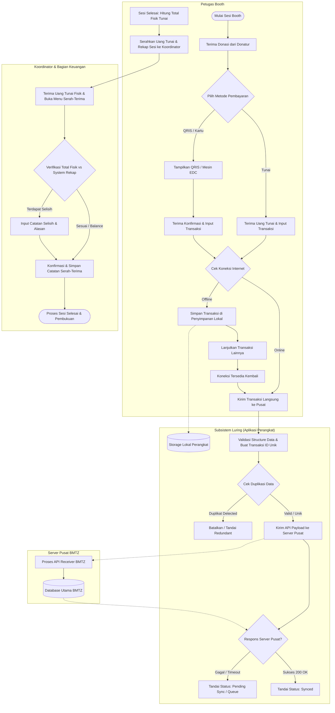

# SOFTWARE REQUIREMENTS SPECIFICATION (SRS)

## Subsistem Penerimaan Donasi Luring — BMTZ

* **ID Dokumen:** BMTZ-SRS-OFFLINE-001
* **Versi:** 0.1
* **Status:** Draft — Untuk Validasi Stakeholder
* **Tanggal:** 21 Oktober 2026
* **Organisasi:** Baitulmal Tazkia
* **Kelompok:** Kelompok 6
* **Bahasa:** Indonesia
* **Standar Acuan:** ISO/IEC/IEEE 29148:2018
* **Acuan Kualitas Tambahan:** ISO/IEC 25010:2023

---

### Kontrol Dokumen

| Versi | Tanggal | Deskripsi Perubahan | Status |
| :--- | :--- | :--- | :--- |
| 0.1 | 21 Oktober 2026 | Penyusunan awal SRS berdasarkan workbook proyek dan informasi yang tersedia. | Draft |

### Persetujuan Dokumen

| Peran | Nama | Status Persetujuan |
| :--- | :--- | :--- |
| Perwakilan stakeholder BMTZ | Belum ditentukan | Belum disetujui |
| Koordinator proyek | Belum ditentukan | Belum disetujui |
| Perwakilan tim pengembang | Belum ditentukan | Belum disetujui |
| Perwakilan penguji | Belum ditentukan | Belum disetujui |

> **Catatan:** Dokumen ini merupakan spesifikasi awal untuk proses elisitasi, analisis, dan validasi kebutuhan. Kebutuhan berstatus kandidat belum boleh dianggap sebagai keputusan final sebelum memperoleh konfirmasi dari stakeholder yang berwenang.

---

## 1. Pendahuluan

### 1.1 Tujuan Dokumen
Dokumen Software Requirements Specification (SRS) ini mendefinisikan kebutuhan awal perangkat lunak untuk Subsistem Penerimaan Donasi Luring Baitulmal Tazkia.

Dokumen ini bertujuan untuk:
1. Mendefinisikan ruang lingkup dan batasan subsistem.
2. Mengidentifikasi kebutuhan fungsional dan nonfungsional.
3. Menetapkan kebutuhan awal terkait pencatatan donasi dalam kondisi koneksi internet tidak stabil.
4. Menjelaskan kebutuhan pengelolaan transaksi, sinkronisasi data, dan pelaporan penerimaan.
5. Menjadi dasar perancangan, implementasi, pengujian, dan validasi bersama stakeholder.
6. Menyediakan keterlacakan antara kebutuhan, sumber, dan metode verifikasi.

### 1.2 Ruang Lingkup Produk
Subsistem Penerimaan Donasi Luring merupakan bagian dari sistem penerimaan donasi Baitulmal Tazkia yang digunakan dalam kegiatan pengumpulan donasi melalui booth di pusat perbelanjaan, masjid, dan lokasi acara.

Subsistem ini direncanakan untuk mendukung pencatatan donasi menggunakan perangkat yang koneksi internetnya tidak selalu tersedia, pengelolaan informasi transaksi, serta pengiriman data ke sistem pusat ketika koneksi tersedia.

Ruang lingkup awal mencakup:
* Pencatatan donasi tunai, QRIS, dan kartu.
* Penyimpanan transaksi ketika koneksi internet tidak tersedia.
* Sinkronisasi transaksi ke sistem pusat ketika koneksi tersedia.
* Penanganan potensi duplikasi transaksi.
* Pencatatan serah-terima uang tunai beserta tahapan yang dapat ditelusuri.
* Penyusunan rekap penerimaan berdasarkan sesi atau acara.
* Dukungan pertukaran data dengan subsistem terkait melalui kontrak API yang disepakati.

*Detail teknis, aturan operasional, dan kewenangan pengguna masih perlu divalidasi.*

### 1.3 Tujuan Bisnis

| ID Tujuan | Tujuan Bisnis |
| :--- | :--- |
| **BG-01** | Mendukung pencatatan penerimaan donasi secara konsisten pada kegiatan booth luring. |
| **BG-02** | Mengurangi risiko kehilangan dan duplikasi data transaksi. |
| **BG-03** | Mendukung sinkronisasi data dari perangkat petugas ke sistem pusat. |
| **BG-04** | Mendukung penelusuran tahapan serah-terima uang tunai. |
| **BG-05** | Menyediakan rekap penerimaan donasi berdasarkan sesi atau acara. |
| **BG-06** | Mendukung pertukaran data dengan subsistem terkait sesuai kontrak antarmuka yang disepakati. |

### 1.4 Definisi dan Singkatan

| Istilah | Definisi |
| :--- | :--- |
| **SRS** | *Software Requirements Specification*, dokumen spesifikasi kebutuhan perangkat lunak. |
| **BMTZ** | Baitulmal Tazkia. |
| **Booth** | Lokasi pengumpulan donasi pada kegiatan atau acara. |
| **Sesi** | Periode operasional booth yang ditetapkan untuk pencatatan penerimaan. |
| **Offline-first** | Pendekatan yang memungkinkan fungsi tertentu tetap berjalan ketika koneksi internet tidak tersedia. |
| **Sinkronisasi** | Proses pertukaran data antara perangkat lokal dan sistem pusat. |
| **API** | *Application Programming Interface*, antarmuka pertukaran data antarsistem. |
| **QRIS** | *Quick Response Code Indonesian Standard*. |
| **Audit trail** | Catatan aktivitas dan perubahan yang dapat digunakan untuk menelusuri suatu kejadian. |
| **Stakeholder** | Pihak yang memiliki kepentingan atau kewenangan terhadap proses maupun sistem. |
| **TBD** | *To Be Determined*, hal yang masih perlu ditentukan. |
| **RTM** | *Requirements Traceability Matrix*, matriks keterlacakan kebutuhan. |

### 1.5 Referensi
1. Workbook Proyek Kelompok 6 — Booth Luring, Baitulmal Tazkia.
2. ISO/IEC/IEEE 29148:2018 — *Systems and software engineering — Life cycle processes — Requirements engineering*.
3. ISO/IEC 25010:2023 — *Systems and software Quality Requirements and Evaluation (SQuaRE) — Product quality model*.
4. Kontrak API antarsubsistem BMTZ — *menunggu dokumen final*.
5. Catatan hasil wawancara dan observasi stakeholder — *belum tersedia pada tahap penyusunan ini*.

---

## 2. Deskripsi Umum

### 2.1 Perspektif Produk
Subsistem Penerimaan Donasi Luring merupakan bagian dari ekosistem sistem BMTZ. Subsistem berinteraksi dengan petugas booth, data donasi, sistem pusat, layanan pembayaran, dan subsistem lain yang membutuhkan data penerimaan donasi.

Gambaran konteks awal:
* **Petugas booth:** mencatat transaksi penerimaan donasi.
* **Sistem penerimaan donasi luring:** mengelola pencatatan lokal, status transaksi, dan sinkronisasi.
* **Sistem pusat BMTZ:** menerima data transaksi yang disinkronkan sesuai kontrak API.
* **Layanan pembayaran:** menyediakan informasi yang relevan untuk pembayaran digital sesuai integrasi yang disepakati.
* **Subsistem rekonsiliasi dan settlement:** menggunakan data transaksi dan setoran yang relevan.
* **Subsistem relawan dan operasional acara:** menyediakan informasi penugasan petugas per sesi sesuai kontrak integrasi.

### 2.2 Diagram Proses Bisnis (BPMN / Swimlane Diagram)

Berikut merupakan alur proses bisnis operasional pencatatan donasi luring, sinkronisasi data, dan serah-terima uang tunai dalam bentuk diagram Mermaid:

### 2.3 Kelas Pengguna dan Pemangku Kepentingan

| Pengguna / Pihak | Tanggung Jawab atau Kepentingan Awal | Status |
| :--- | :--- | :--- |
| **Petugas booth** | Mencatat penerimaan donasi pada kegiatan booth. | Kandidat; perlu validasi |
| **Koordinator** | Terlibat dalam proses serah-terima uang tunai. | Kandidat; perlu validasi |
| **Bagian keuangan** | Berkepentingan terhadap data setoran dan penerimaan. | Kandidat; perlu validasi |
| **Administrator sistem** | Mengelola akses atau konfigurasi sistem jika diperlukan. | Peran dan kewenangan belum ditentukan |
| **Pengelola operasional BMTZ** | Memvalidasi prosedur dan aturan bisnis. | Nama narasumber belum ditentukan |
| **Tim pengembang** | Mengimplementasikan kebutuhan yang telah disepakati. | Tim proyek |
| **Tim penguji** | Memverifikasi pemenuhan kebutuhan sistem. | Tim proyek |

### 2.4 Lingkungan Operasional
* Kegiatan berlangsung pada booth di mal, masjid, dan lokasi acara.
* Perangkat petugas dapat mengalami keterbatasan koneksi internet.
* Pencatatan transaksi perlu mendukung kondisi koneksi tidak tersedia.
* Data perlu dikirimkan ke sistem pusat ketika koneksi tersedia.
* Jenis perangkat, sistem operasi, browser, spesifikasi minimum, serta kebijakan penyimpanan lokal belum ditentukan.

### 2.5 Batasan dan Ketergantungan
1. Subsistem merupakan bagian dari proyek BMTZ dan harus mengikuti batas integrasi antarsubsistem.
2. Pertukaran data antarsubsistem dilakukan melalui kontrak API yang disepakati.
3. Struktur database internal tidak boleh mengasumsikan hubungan foreign key langsung melintasi batas subsistem.
4. Integrasi pembayaran QRIS bergantung pada kontrak dan ketersediaan layanan pembayaran yang digunakan proyek.
5. Struktur identitas donatur dan data transaksi harus mengikuti kontrak dengan subsistem terkait.
6. Detail teknis penyimpanan lokal, pembuatan ID transaksi, dan penanganan konflik harus diputuskan pada tahap perancangan.
7. Prosedur operasional yang belum diverifikasi tidak boleh dijadikan dasar implementasi final.

### 2.6 Asumsi dan Hal yang Belum Dipastikan

| ID | Pernyataan | Status |
| :--- | :--- | :--- |
| **ASM-01** | Pencatatan transaksi perlu tetap tersedia ketika koneksi internet tidak tersedia. | Berdasarkan ruang lingkup workbook |
| **ASM-02** | Data transaksi perlu disinkronkan ke sistem pusat ketika koneksi tersedia. | Berdasarkan ruang lingkup workbook |
| **ASM-03** | Sistem memerlukan mekanisme untuk mengidentifikasi potensi transaksi duplikat. | Berdasarkan risiko pada workbook |
| **ASM-04** | Setiap tahapan serah-terima uang tunai harus dapat ditelusuri. | Berdasarkan ruang lingkup workbook |
| **ASM-05** | Donatur selalu harus memberikan nama, nomor telepon, atau alamat email. | Belum dikonfirmasi; tidak boleh diasumsikan |
| **ASM-06** | Semua jenis pembayaran dapat diverifikasi secara otomatis. | Belum dikonfirmasi |
| **ASM-07** | Transaksi yang telah dicatat boleh dikoreksi langsung oleh petugas. | Belum dikonfirmasi |

---

## 3. Kebutuhan Fungsional

### 3.1 Pencatatan Donasi

#### FR-01 — Pencatatan Transaksi Donasi
Sistem harus menyediakan fungsi untuk mencatat transaksi penerimaan donasi pada booth yang teridentifikasi.
* **Kriteria verifikasi awal:**
  * Transaksi dapat dimasukkan melalui antarmuka pencatatan.
  * Transaksi yang memenuhi aturan validasi dapat disimpan.
  * Transaksi yang tidak memenuhi aturan validasi tidak diproses sebagai transaksi valid.
* **Status:** Kandidat.

#### FR-02 — Informasi Transaksi
Sistem harus menyimpan informasi transaksi yang diperlukan untuk identifikasi, penelusuran, dan pelaporan.
* **Informasi kandidat meliputi:** Identitas unik transaksi, identitas booth dan sesi, tanggal dan waktu pencatatan, nominal donasi, metode pembayaran, status transaksi, dan status sinkronisasi.
* **Status:** Kandidat; skema data perlu divalidasi.

#### FR-03 — Metode Pembayaran
Sistem harus mendukung pencatatan metode pembayaran tunai, QRIS, dan kartu sesuai ruang lingkup proyek. Sistem harus membedakan pencatatan transaksi dari konfirmasi keberhasilan pembayaran apabila konfirmasi pembayaran tersedia melalui layanan terkait.
* **Kriteria verifikasi awal:**
  * Metode pembayaran yang diizinkan dapat dipilih.
  * Metode yang tidak valid ditolak.
  * Status pembayaran tidak otomatis dianggap berhasil hanya karena data transaksi tersimpan.
* **Status:** Kandidat; aturan konfirmasi pembayaran perlu divalidasi.

### 3.2 Operasi Luring

#### FR-04 — Penyimpanan Lokal
Sistem harus memungkinkan transaksi disimpan pada perangkat ketika koneksi internet tidak tersedia, sesuai kebijakan penyimpanan lokal yang ditetapkan.
* **Kriteria verifikasi awal:**
  * Transaksi yang memenuhi validasi dapat disimpan saat perangkat offline.
  * Pengguna memperoleh informasi mengenai hasil penyimpanan.
  * Data yang belum dikirim ke sistem pusat dapat dibedakan dari data yang telah tersinkron.
* **Status:** Kandidat.

#### FR-05 — Status Sinkronisasi
Sistem harus menyediakan status yang membedakan transaksi yang belum disinkronkan, sedang diproses, berhasil disinkronkan, atau mengalami kegagalan, sesuai rancangan yang disepakati.
* **Kriteria verifikasi awal:** Status sesuai dengan hasil proses sinkronisasi, kegagalan sinkronisasi tidak ditampilkan sebagai keberhasilan, serta pengguna dapat mengetahui transaksi yang memerlukan penanganan lebih lanjut.
* **Status:** Kandidat.

#### FR-06 — Sinkronisasi Transaksi
Sistem harus mengirimkan transaksi lokal yang memenuhi ketentuan sinkronisasi ke sistem pusat ketika koneksi tersedia.
* **Kriteria verifikasi awal:**
  * Transaksi yang memenuhi syarat masuk ke proses sinkronisasi.
  * Respons sistem pusat dicatat sesuai kontrak API.
  * Transaksi yang gagal dikirim tetap dapat diidentifikasi untuk penanganan berikutnya.
* **Status:** Kandidat; kontrak API dan aturan pengiriman ulang belum ditetapkan.

#### FR-07 — Penanganan Transaksi Duplikat
Sistem harus mendukung identifikasi dan penanganan potensi duplikasi transaksi selama pencatatan atau sinkronisasi.
* **Kriteria verifikasi awal:**
  * Pengiriman ulang transaksi yang sama dapat dikenali berdasarkan identitas dan aturan deduplikasi yang disepakati.
  * Sistem tidak menghasilkan transaksi tambahan hanya akibat pengiriman ulang yang sama apabila mekanisme idempotensi telah ditetapkan.
  * Konflik yang tidak dapat diputuskan secara otomatis dicatat untuk penanganan lebih lanjut.
* **Status:** Kandidat; strategi deduplikasi dan resolusi konflik perlu dirancang.

### 3.3 Serah-Terima Uang Tunai

#### FR-08 — Pencatatan Serah-Terima
Sistem harus mendukung pencatatan serah-terima uang tunai dari petugas kepada koordinator dan tahapan selanjutnya sesuai prosedur BMTZ yang telah divalidasi.
* **Informasi kandidat meliputi:** Referensi sesi atau acara, pihak yang menyerahkan, pihak yang menerima, nominal uang tunai, waktu serah-terima, status pemeriksaan/konfirmasi, dan catatan selisih jika ditemukan.
* **Status:** Kandidat; alur dan pihak yang berwenang perlu divalidasi.

#### FR-09 — Penelusuran Tahapan Serah-Terima
Sistem harus menyediakan informasi yang dapat digunakan untuk menelusuri tahapan serah-terima uang tunai sesuai prosedur yang disepakati.
* **Status:** Kandidat.

### 3.4 Pelaporan dan Pencarian

#### FR-10 — Rekap Penerimaan
Sistem harus menyediakan rekap penerimaan donasi berdasarkan sesi booth atau rentang waktu yang dipilih.
* **Status:** Kandidat; aturan perhitungan perlu divalidasi.

#### FR-11 — Rincian Metode Pembayaran
Sistem harus mendukung penyajikan rincian penerimaan berdasarkan metode pembayaran yang disepakati.
* **Status:** Kandidat.

#### FR-12 — Pencarian Transaksi
Sistem harus menyediakan fungsi pencarian transaksi berdasarkan kriteria yang disetujui (misal: ID transaksi, sesi, tanggal, atau metode pembayaran).
* **Status:** Kandidat; daftar filter perlu divalidasi.

#### FR-13 — Penutupan Sesi atau Acara
Sistem harus mendukung penyusunan rekap penutupan penerimaan per sesi atau acara. Aturan penutupan harus memperhatikan transaksi yang belum tersinkron dan status pembayaran sesuai kebijakan yang disepakati.
* **Status:** Kandidat; prosedur penutupan perlu divalidasi.

### 3.5 Akses dan Pengelolaan Data

#### FR-14 — Pengendalian Akses
Sistem harus membatasi akses terhadap fungsi dan data sesuai peran pengguna yang telah disetujui.
* **Status:** Kandidat; matriks hak akses belum ditetapkan.

#### FR-15 — Koreksi dan Pembatalan Transaksi
Apabila koreksi atau pembatalan transaksi diizinkan, sistem harus menerapkannya sesuai kewenangan dan prosedur yang disetujui serta menjaga keterlacakan perubahan (*audit trail*).
* **Status:** Kandidat; kewenangan koreksi dan pembatalan belum dikonfirmasi.

#### FR-16 — Pertukaran Data dengan Sistem Terkait
Sistem harus menyediakan pertukaran data melalui kontrak API yang disepakati dengan sistem pusat dan subsistem terkait.
* **Status:** Kandidat; kontrak API final belum tersedia.

---

## 4. Kebutuhan Antarmuka Eksternal

### 4.1 Antarmuka Pengguna

| ID | Kebutuhan Antarmuka Pengguna |
| :--- | :--- |
| **UI-01** | Antarmuka pencatatan harus menampilkan label dan informasi input yang jelas. |
| **UI-02** | Sistem harus memberikan umpan balik terhadap input yang tidak valid. |
| **UI-03** | Status penyimpanan lokal dan sinkronisasi harus dapat dibedakan. |
| **UI-04** | Pesan kegagalan harus membantu pengguna memahami tindakan berikutnya tanpa menampilkan informasi sensitif. |
| **UI-05** | Antarmuka web harus dapat digunakan pada perangkat lapangan yang didukung. |
| **UI-06** | Validasi input harus diterapkan pada sisi server, tidak hanya pada sisi antarmuka pengguna. |

### 4.2 Antarmuka Perangkat Keras
Jenis perangkat, sistem operasi, serta kebutuhan printer, pemindai, kamera, atau perangkat pembayaran belum ditentukan. Tidak ada ketergantungan terhadap perangkat keras tertentu yang ditetapkan dalam dokumen ini.

### 4.3 Antarmuka Perangkat Lunak

| ID | Sistem / Layanan | Kebutuhan Antarmuka |
| :--- | :--- | :--- |
| **IF-01** | Sistem pusat BMTZ | Pertukaran data transaksi dan identitas sesuai kontrak API. |
| **IF-02** | Layanan pembayaran QRIS | Pertukaran informasi pembayaran sesuai integrasi dan kontrak yang berlaku. |
| **IF-03** | Subsistem Rekonsiliasi & Settlement | Penyediaan data transaksi dan informasi setoran yang relevan. |
| **IF-04** | Subsistem Relawan & Operasional Acara | Penggunaan informasi penugasan petugas per sesi sesuai kontrak API. |
| **IF-05** | Sistem / Penyimpanan lokal | Penyimpanan transaksi saat offline dan pengelolaan antrean sinkronisasi sesuai rancangan. |

### 4.4 Antarmuka Komunikasi
Sistem perlu mendukung pertukaran data dengan sistem pusat melalui mekanisme komunikasi yang disepakati. Protokol, format pesan, batas waktu respons, serta mekanisme autentikasi belum ditetapkan dalam SRS versi ini.

---

## 5. Kebutuhan Data

### 5.1 Entitas Data Awal

| Entitas | Deskripsi | Atribut Kandidat |
| :--- | :--- | :--- |
| **Transaksi Donasi** | Catatan penerimaan donasi. | ID transaksi, nominal, waktu pencatatan, metode pembayaran, status. |
| **Booth** | Lokasi pengumpulan donasi. | ID booth, nama atau identitas lokasi. |
| **Sesi Acara** | Periode operasional booth. | ID sesi, referensi acara, waktu mulai dan selesai. |
| **Pengguna / Petugas** | Pihak yang menggunakan sistem. | ID pengguna, identitas peran sesuai kebijakan. |
| **Status Sinkronisasi** | Informasi hasil pertukaran data. | Status, waktu percobaan, waktu berhasil, informasi kegagalan. |
| **Serah-Terima Tunai** | Catatan perpindahan uang tunai. | ID catatan, pihak penyerah, pihak penerima, nominal, waktu, status. |
| **Catatan Aktivitas** | Catatan tindakan (*audit log*). | Pelaku, tindakan, waktu, referensi data terkait. |

### 5.2 V
